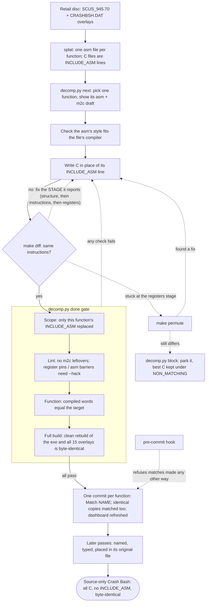

# crash_bash_decomp

Work-in-progress matching decompilation of the North American PlayStation
release of Crash Bash, target `SCUS_945.70`.

**Goal: a source-only Crash Bash.** Every function in the executable and the
15 code overlays should exist as C that compiles back to the retail bytes. The
data should exist as C tables and structs. Nothing should be included as
assembly. The code should be named, typed and split into the files it came
from. The PsyQ libraries are the one exception: they come from Sony's own
objects, which are linked in place rather than decompiled. The result should
read like the source the developers wrote and rebuild the game byte for byte.

This repository is source-only in the other sense too. It does not contain
disc images, extracted game files, Sony PsyQ SDK files, compiler binaries, or
generated split output. Contributors must provide their own legally obtained
copy of the game.

## Target

| Field | Value |
|---|---|
| Game | Crash Bash, USA |
| Executable | `SCUS_945.70` |
| Target path | `disc/SCUS_945.70` (extracted from your bin/cue) |
| SHA-1 | `c4a06208612ff2625b9083596d36fdf60b01be5f` |
| Entry PC | `0x8002E7B0` |
| Text VRAM | `0x80010000..0x80079000` |

## Progress


Progress is measured in **bytes of code** produced by C that compiles to the
retail bytes, game code and PsyQ library reported apart. The dashboard
[`docs/index.html`](docs/index.html) is self-contained (no network, works from
disk or GitHub Pages on `/docs`). It shows how much game code is matched,
named and in C as data, and how many functions are parked; a history chart and
one chart comparing every binary, each switchable between bytes and functions;
and a table per binary. `docs/progress.json` holds the full data for scripts
and `docs/badges/` feeds the badges above. Regenerate all three with
`make progress`; `decomp.py done` and `decomp.py block` do it on every match or
park. `tools/scripts/check_progress.py` recounts everything from the sources
and checks the dashboard against it. This README intentionally avoids
hardcoded numbers.

A function counts only when **every binary still matches the retail bytes**
after it is added: `done` rebuilds the exe and all overlays from scratch and
compares them before recording or committing anything. Functions still included as assembly receive
no credit. PsyQ code is not decompiled: Sony's own converted objects are linked
in place and counted as library progress, separately from game code.

Binary matching is only one quality level. A file is finished when it is also
named, typed and placed in its subsystem; [docs/CONVENTIONS.md](docs/CONVENTIONS.md)
defines that bar. See [CONTRIBUTING.md](CONTRIBUTING.md) for the working contract.

## How functions are matched

Every function starts as assembly, split from the retail binaries and pulled
into its C file with `INCLUDE_ASM`. Functions are then replaced with C by hand,
by a person or an AI agent, **one function per commit**. Each one goes through
a single validation gate, `decomp.py done`, before anything is recorded. A
match is the first step. The same function is later named, typed and moved
into its original file, until no assembly is left.



What gets matched in what order, and when each binary counts as finished, is
in [docs/ROADMAP.md](docs/ROADMAP.md). The loop is described in
[docs/MATCHING.md](docs/MATCHING.md). An AI agent runs
it one function at a time with the `/match-function` project skill
(`.claude/skills/match-function`), or several at once with the swarm
([tools/swarm](tools/swarm/README.md)): parallel Claude workers do the matching
and one integrator commits each match through the same `done` gate. Big
functions get resumable multi-session workers there (big mode). The bulk
m2c matcher (`decomp.py auto`) is retired.

## How the game is built

`SCUS_945.70` is the resident executable: boot, the main loop and game code
(`0x80010000..0x8002E7A8`), followed by Sony's PsyQ 4.7 libraries (LIBGPU,
LIBGTE, LIBCD, LIBSPU, LIBSND, LIBETC, LIBAPI, LIBC, LIBC2, LIBCARD, LIBMCRD, LIBPAD),
then `.rodata` (game, then library) and `.data`. Most of the game's code lives
in overlays inside `CRASHBSH/CRASHBSH.DAT`, loaded at runtime: the engine module
(`0x80078C90`) and 14 minigame/mode overlays that take turns in one slot
(`0x800B32B4`). Each overlay is a build target of its own, linked separately
against the executable's symbols. The memory map, the section boundaries and the
build pipeline are described in [docs/ARCHITECTURE.md](docs/ARCHITECTURE.md).

## Layout

- `src/main/` - the executable's game code: `main.c` (to be split into
  subsystem files as translation-unit boundaries are found), and the units
  split out so far, named by address (`8002d488.c`, built with gcc 2.7.2,
  and `8002e0f0.c`). All PsyQ code is Sony's own objects, linked in place;
  only the hand-written `2MBYTE.OBJ` is asm (`asm/main/psyq/2mbyte.s`).
- `src/overlays/<overlay>/` - one directory per overlay binary: `engine` and
  the slot overlays `ovl5d`..`ovl6a`, named by their id word.
- `include/` - shared headers; game headers go under `include/bash/`, one owner
  per declaration. `include_asm.h` and `macro.inc` are generated by splat.
- `configs/USA/` - splat config (`main.yaml`, `overlays/`), symbols
  (`sym.main.txt`), relocations (`rel.main.txt`), retail checksums
  (`checksum.sha`), compiler settings (`project.mk`) and PsyQ provenance
  (`psyq/`: objects found, their layout, linker glue).
- `tools/scripts/` - build, match and report helpers (`decomp.py` is the main
  CLI); `tools/docker/` - the toolchain image; `tools/hooks/` - the pre-commit
  hook that keeps game data out of git and refuses matches made outside
  `decomp.py done` (enable with `git config core.hooksPath tools/hooks`).
- `.claude/skills/match-function/` - the AI agent's matching loop.
- `.decomp/` - matching state: function index, statuses and progress history.
- `docs/` - the dashboard, badges and contracts.

Generated directories such as `asm/`, `linkers/`, `build/`, `assets/`, `disc/`
and `ext/` are intentionally ignored, along with `objdiff.json` and local
working notes (`*.local.md`).

## Toolchain

Everything runs in a Docker image (`tools/docker/Dockerfile`), so the only
host requirement is Docker Desktop. `tools/dk <command>` (or `tools\dk.ps1` from
PowerShell) runs a command in it with the repository mounted at `/work`; the
first call builds the image.

| Component | Source | Path in the image |
|---|---|---|
| Binutils (`as`, `ld`, `objcopy`, `cpp`) | Ubuntu `binutils-mipsel-linux-gnu` | `mipsel-linux-gnu-*` on `PATH` |
| GCC `cc1` (2.5.7 to 2.8.1) | [decompals/old-gcc](https://github.com/decompals/old-gcc) | `/opt/gcc/<version>/cc1` |
| ASPSX emulation | [mkst/maspsx](https://github.com/mkst/maspsx) | `/opt/maspsx/maspsx.py` |
| Splitter | [splat](https://github.com/ethteck/splat) | `python3 -m splat` |
| Decompiler / permuter | [m2c](https://github.com/matt-kempster/m2c), [decomp-permuter](https://github.com/simonlindholm/decomp-permuter) | `/opt/m2c`, `/opt/permuter` |
| Disc extraction | [mkpsxiso](https://github.com/Lameguy64/mkpsxiso) `dumpsxiso` | on `PATH` |

The compiler profile is in `configs/USA/project.mk`: GCC 2.8.1 (`2.8.1-psx`),
`-O2 -G0`, maspsx `--aspsx-version=2.86`. Change it with
`tools/dk python3 tools/scripts/decomp.py config`, never by patching the
compiler or assembler.

Sony's SDK is fetched per machine into ignored `ext/`:
`psyq-4.7-converted-full.7z` from [psx.arthus.net](http://psx.arthus.net/sdk/Psy-Q/)
extracted to `ext/psyq47/` (headers and the converted libraries the link uses).

Tool paths are overridable for a native Linux setup (make variables or
environment): `CROSS`, `GCC_ROOT`, `CC1`, `MASPSX`, `PSYQ_SDK`, and for
`decomp.py` `GCC_ROOT`, `MASPSX_PY`, `M2C_PY`, `PERMUTER_PY`, `CROSS`.

## Quick Start

```sh
mkdir -p disc ext/psyq47
cp "/path/to/Crash Bash.bin" disc/CrashBash.bin     # and a .cue naming CrashBash.bin
tar -xf psyq-4.7-converted-full.7z -C ext/psyq47    # Windows tar reads 7z

git config core.hooksPath tools/hooks                 # data guard + match gate
tools/dk python3 tools/scripts/decomp.py extract disc/CrashBash.cue
tools/dk make split
tools/dk make check
```

`extract` dumps the disc and copies the executable to `disc/`, `make split`
regenerates `asm/` and `linkers/`, `make build` compiles and links
`build/main.exe`, and `make check` verifies it against `configs/USA/checksum.sha`.
Useful extras:

```sh
tools/dk make verify                 # clean rebuild + checksum
tools/dk make progress               # dashboard + badges
tools/dk make disc                   # pack build/CrashBash.bin/.cue to boot in an emulator
tools/dk make disc-check             # ... and check it is the retail image byte for byte
tools/dk make replay                 # play a recording on the retail and built discs, compare frames
```

Matching one function (see [How functions are matched](#how-functions-are-matched)):

```sh
tools/dk python3 tools/scripts/decomp.py next            # pick a function: asm + draft
tools/dk make diff FUNC=func_80012345                    # after writing its C; ends with a STAGE line
tools/dk make permute FUNC=func_80012345                 # if stuck at the registers stage
tools/dk python3 tools/scripts/decomp.py done func_80012345 --commit --note "what made it match"
```

## Local dashboard and objdiff

Instead of a decomp.dev page, progress is published by the repository itself:
`docs/index.html` (enable GitHub Pages on `/docs` to share it) and the badges
above, both regenerated by `make progress` and committed with each match.

[objdiff](https://github.com/encounter/objdiff) is supported for per-function
diffing. `make objdiff-config` writes `objdiff.json` (generated, not
committed) and builds a target object per source file from the original
assembly; `make report` writes `build/report.json`, the same report format
decomp.dev reads. Point the objdiff GUI at the repository after running
`make objdiff-config`; it rebuilds through `tools/dk.ps1`.

## License

No license has been chosen yet. Game code and data remain the property of
their respective owners; this repository contains only reimplementation source.
