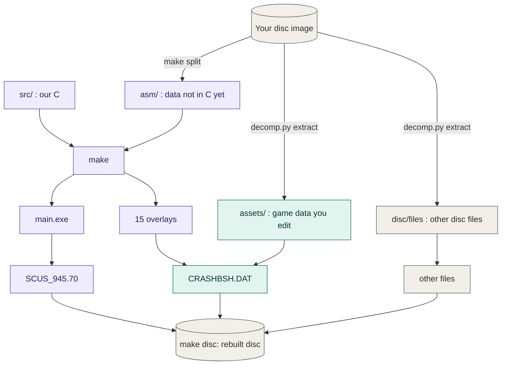

# crash_bash_decomp

Work-in-progress matching decompilation of Crash Bash (USA, `SCUS_945.70`) for
the PlayStation.

**Goal: a source-only Crash Bash.** Every function in the executable and its 15
code overlays becomes C that compiles back to the retail bytes, the data
becomes C, and everything is named, typed and split into the files it came
from. Sony's PsyQ libraries are the exception: their own objects are linked in
place. The game's files (textures, models and their animations, sounds, music,
text) come out of your disc as editable files and go back byte for byte
([docs/ASSETS.md](docs/ASSETS.md)).

The repository holds no game files, SDK files or compiler binaries. You need
your own copy of the game.

## Target

| Field | Value |
|---|---|
| Game | Crash Bash, USA |
| Executable | `SCUS_945.70` (in `disc/`, extracted from your bin/cue) |
| SHA-1 | `c4a06208612ff2625b9083596d36fdf60b01be5f` |
| Entry PC | `0x8002E7B0` |
| Text VRAM | `0x80010000..0x80079000` |

## Progress


Progress counts bytes of code produced by matching C, game code and PsyQ
reported apart. The dashboard is [`docs/index.html`](docs/index.html)
(self-contained; works from disk or GitHub Pages on `/docs`): progress over
time and per day, and a map that shows, by size, every game function matched
or not, every function named or not, or every data block in C or still asm,
each with the largest ones left. `decomp.py
progress` regenerates it from `tools/scripts/dashboard.html` (`make progress`,
and every match through `done`), with its source scans cached in `build/cache/`.
While a swarm runs, the page also shows the run's live status (at the bottom) from
`docs/swarm.js`, a local git-ignored file ([tools/swarm](tools/swarm/README.md)).
A function counts only when the exe and all overlays still rebuild
byte-identical.

## How functions are matched

Each function starts as assembly (`INCLUDE_ASM`) and is replaced with C by
hand, by a person or an AI agent, one function per commit. Every match goes
through one gate, `decomp.py done`, which checks the change, the function's
words and a clean rebuild of every binary before it commits. The process and
its diagram are in [docs/MATCHING.md](docs/MATCHING.md), the order of work in
[docs/ROADMAP-B.md](docs/ROADMAP-B.md) (what is left; [done](docs/ROADMAP-A.md)), and the rules in
[CONTRIBUTING.md](CONTRIBUTING.md) and [docs/CONVENTIONS.md](docs/CONVENTIONS.md).
Agents use the `/match-function` skill, or the [swarm](tools/swarm/README.md)
for many functions at once.

## Names, types and files

Names, types and file boundaries come from the code itself and from what
other discs leaked: the headers in retail's own archive, and the debug
records, symbol tables and line tables left on the prototype and demo
discs. What each disc gave, and the tools that scan a disc and apply it, are
in [docs/PROTOTYPES.md](docs/PROTOTYPES.md); the evidence for each file
boundary is in [docs/ARCHITECTURE.md](docs/ARCHITECTURE.md).

## How the game is built

`SCUS_945.70` holds the game's resident code (`0x80010000..0x8002E7A8`), Sony's
PsyQ 4.7 libraries, then `.rodata` and `.data`. Most game code is in overlays
inside `CRASHBSH/CRASHBSH.DAT`: the engine (`0x80078C90`) and 14 minigame and
mode overlays sharing one slot (`0x800B32B4`). Each overlay is its own build
target. Details: [docs/ARCHITECTURE.md](docs/ARCHITECTURE.md).

From your disc image to a rebuilt disc. All of its code comes from this repository's build:
our C (every game function is C), plus the rodata and data not yet in C, which splat cuts
from the disc. Its game data comes from `assets/`
([docs/ASSETS.md](docs/ASSETS.md)), and `make disc-check` proves the result is the retail disc
byte for byte ([docs/PLAYING.md](docs/PLAYING.md)).



Purple is code, green is game data. `main.exe` becomes the disc's boot file (`SCUS_945.70`);
the engine and the 14 minigame overlays go into `CRASHBSH.DAT` with the game data from
`assets/`; the other files (`SYSTEM.CNF`, the licence data, the `BASHY.` filler, the bundled
Spyro 3 demo) come from the disc as they are. As data is turned into C it moves from `asm/` to
`src/`, as the functions did; the disc stays identical throughout.

## Layout

- `src/main/` - the executable's game code, split into its files: named by
  what they hold where that is known (`dbase.c`, `scripts.c`, `sound.c`,
  `card.c`, ...), by their first function's address until then (`80017164.c`).
- `src/overlays/<overlay>/` - one directory per overlay (`engine`,
  `bash`..`hub`), split the same way where the binary or a leak proves a
  file starts (`panel.c` is `PANEL.CPP`, `pause.c` `PAUSE.CPP`).
- `include/bash/` - game headers, one owner per declaration.
- `configs/USA/` - splat config, symbols, relocations, checksums, compiler
  settings (`project.mk`), PsyQ provenance (`psyq/`) and the names of the
  game archive's files (`dat_names.txt`, from CTR-tools).
- `tools/scripts/` - `decomp.py` (the main CLI) and build helpers; the game
  data tools: `dat.py` (the archive), `tex.py`, `mdl.py` + `gltf.py`,
  `sfx.py`, `tga.py`, `txt.py` (one per format) and `pack_disc.py`; the leak
  tools `proto_scan.py`, `proto_apply.py`, `proto_types.py`; `split_unit.py`
  (splits a source file in two); `tools/swarm/`, `tools/docker/`,
  `tools/hooks/`.
- `tools/reference/` - third-party source kept to read, not built: GCC 2.8.1 and
  2.7.2.3 (the C compiler and its MIPS target, GPL).
- `.claude/skills/match-function/` - the agent's matching loop.
- `.decomp/` - matching state; `docs/` - dashboard, badges and documentation.

Ignored, never committed:

- `disc/` - your disc image and what `decomp.py extract` unpacks from it; `protos/` -
  prototype and demo discs (what each gave: [docs/PROTOTYPES.md](docs/PROTOTYPES.md)); `ext/` - third-party downloads (PsyQ).
- `asm/`, `linkers/` - generated by `make split`; `build/` - build output, all of it
  disposable (`make clean` deletes it).
- `assets/` - the game's data as editable files (textures, models with their animations,
  sounds, music, text; docs/ASSETS.md), extracted from your disc; `make disc` builds the disc from it. Your edits live here: delete it
  (or `dat.py extract --force`) to start again from the retail files.
- `scratch/` - your notes and drafts.

All of it but your edits and notes comes back from your disc image (and the PsyQ download): the
Quick Start below.

## Toolchain

Everything runs in Docker: `tools/dk <command>` (or `tools\dk.ps1`) runs it in
the image with the repository at `/work`, building the image on first use.

| Component | Source |
|---|---|
| Binutils | Ubuntu `binutils-mipsel-linux-gnu` |
| GCC `cc1` 2.5.7-2.8.1 | [decompals/old-gcc](https://github.com/decompals/old-gcc) (2.8.1-psx also rebuilds from source: `tools/cc1/`) |
| ASPSX emulation | [mkst/maspsx](https://github.com/mkst/maspsx) |
| Splitter | [splat](https://github.com/ethteck/splat) |
| Decompiler, permuter | [m2c](https://github.com/matt-kempster/m2c), [decomp-permuter](https://github.com/simonlindholm/decomp-permuter) |
| Disc tools | [mkpsxiso](https://github.com/Lameguy64/mkpsxiso) |
| Game data | [Pillow](https://python-pillow.org) (PNG); formats checked against [CTR-tools](https://github.com/DCxDemo/CTR-tools) |

The compiler profile is in `configs/USA/project.mk` (GCC 2.8.1, `-O2 -G0`,
maspsx `--aspsx-version=2.86`); change it with `decomp.py config`. Two units of
the executable (`src/main/modchip.c`, `8002e0f0.c`) were built with GCC 2.7.2
and Sony's assembler: their settings are per unit in the Makefile, and
`tools/scripts/aspsx_fill.py` reproduces what that assembler (and Sony's build
of the compiler) did to the code. The source of GCC 2.8.1 and 2.7.2.3 is kept in
`tools/reference/` to read when a match depends on what a compiler pass does. Sony's SDK
goes in the ignored `ext/psyq47/` (`psyq-4.7-converted-full.7z` from
[psx.arthus.net](http://psx.arthus.net/sdk/Psy-Q/)).

## Quick Start

```sh
mkdir -p disc ext/psyq47
cp "/path/to/Crash Bash.bin" disc/CrashBash.bin     # and a .cue naming CrashBash.bin
tar -xf psyq-4.7-converted-full.7z -C ext/psyq47        # or: tools/get_psyq.sh (downloads and checks it)

git config core.hooksPath tools/hooks                 # data guard + match gate
tools/dk python3 tools/scripts/decomp.py extract disc/CrashBash.cue   # and the game data to assets/
tools/dk make split
tools/dk make check                                   # build and compare with retail
tools/dk make disc-check                              # a disc image, the same as retail
```

Matching one function (every game function is matched; this is the route for reworking one):

```sh
tools/dk python3 tools/scripts/decomp.py next            # pick a function: asm + draft
tools/dk make diff FUNC=func_80012345                    # after writing its C
tools/dk make permute FUNC=func_80012345                 # if stuck at the registers stage
tools/dk python3 tools/scripts/decomp.py done func_80012345 --commit --note "what made it match"
```

Other targets: `make verify` (clean rebuild + check), `make progress`,
`make disc` / `make disc-check` (a bootable image, and that it equals retail;
how to play it and edit the game data: [docs/PLAYING.md](docs/PLAYING.md)),
`make test-tools` (the Python tools' tests), `make objdiff-config` (for
[objdiff](https://github.com/encounter/objdiff)).

## License

No license has been chosen yet. Game code and data remain the property of
their respective owners; this repository contains only reimplementation source.
