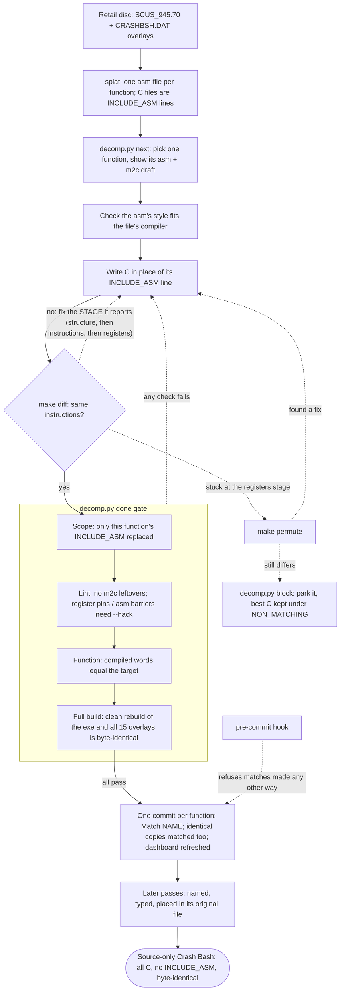

# Matching workflow

Functions are matched by hand, by a person or an AI agent, **one function per
commit**, and every commit goes through one validation gate, `decomp.py done`.
The retired bulk matcher (`decomp.py auto`) left drafts that `next` still
shows as a starting point.



## The loop

All commands run through `tools/dk` (Docker).

1. **Pick:** `tools/dk python3 tools/scripts/decomp.py next`
   prints the target, its callers, the asm and a draft (m2c, or an earlier
   compiling draft). `next --func NAME` picks a specific one, `--seg REGEX`
   restricts to a segment (`overlays/ovl62`, ...). From about 600 bytes up,
   also read [Big functions](#big-functions).
2. **Check the unit.** Compare the asm's style with its file's compiler
   settings: every global store as `lui $at` + `sw`, or jump delay slots
   filled from a store, is gcc 2.7.2 through ASPSX, not `main.c`'s gcc 2.8.1
   (see the Diff patterns row for `func_8002D488`). Code in the wrong unit
   never matches; it needs a split, with per-unit settings in the Makefile
   ([ARCHITECTURE.md](ARCHITECTURE.md), Build pipeline).
3. **Evidence first, then write C.** Before writing anything, gather
   evidence (see [Evidence first](#evidence-first)). Then replace the
   function's `INCLUDE_ASM` line in its source file with C. Use real types
   from `include/` (add structs there, see [CONVENTIONS.md](CONVENTIONS.md)).
   Don't leave m2c leftovers.
4. **Diff:** `tools/dk make diff FUNC=NAME` builds that file and shows
   the target and compiled code aligned (an extra instruction is one `+`
   row, not a shift of everything after it), with runs of identical rows
   cut. Marks: `!` operands differ, `~` moved (statement order), `-`
   target only, `+` compiled only. A `KINDS` line counts them (register,
   operand, moved, missing, extra) for [Classify the
   diff](#classify-the-diff-then-work-through-the-list). It stops after 40
   rows; for more, run
   `tools/dk sh -c 'DIFF_ROWS=300 python3 tools/scripts/decomp.py try NAME'`.
   On a match it also links the binary: `LINK ok`, or `LINK differs` with
   where (data or rodata the C adds or moves; `done` would refuse it).
   Its last line, `STAGE NAME stage n/total`, says how far the function has
   got. Fix the stages in order, since later fixes don't hold while an
   earlier stage is wrong:
   - `structure`: the length or the branch layout differs (control flow,
     loops, jump tables, early returns).
   - `instructions`: same skeleton, some opcodes differ (statement order,
     temps, types, casts).
   - `registers`: operands only.

   Look the symptom up in [Diff patterns](#diff-patterns), then
   [classify the diff and work through its list](#classify-the-diff-then-work-through-the-list).
   For register differences, also read the [cc1 dump](#why-does-a-register-differ).
   Note in your reasoning which items you tried.
5. **Stuck?** If the diff is a tie in instruction order, register choice or
   a merged tail, [read the compiler's rules](#reading-the-compilers-rules)
   for the pass that decides it first. Run the permuter only at the
   `registers` stage, after the evidence step, the checklist for that kind
   of diff, the cc1 dump and that reading:
   `tools/dk make permute FUNC=NAME MINUTES=10`. When it finds something,
   port it by hand and add the general rule to [Diff patterns](#diff-patterns).
   Still stuck: restore the `INCLUDE_ASM` line, keep the best attempt under
   `#ifndef NON_MATCHING`, and run `decomp.py block NAME --note "STAGE line;
   what differs"`. Then move on.
6. **Validate and commit:**
   `tools/dk python3 tools/scripts/decomp.py done NAME --commit --note "what made it match"`

To run this loop for several functions at once, see [tools/swarm](../tools/swarm/README.md):
Claude workers do steps 1-5 in their own clones, and one integrator does step 6 for each.
Big functions go to big-mode workers there, in resumable sessions.

## Big functions

A function of 600 bytes or more rarely matches in one sitting, and the
permuter's random edits get nowhere on hundreds of instructions. Work on it
block by block over several sessions, keeping the best C between them:

- **Work and measure with `decomp.py regions NAME`.** `try`'s `STAGE`
  count compares instruction i with instruction i, so one extra instruction
  makes everything after it a diff, and the count can rise while the C gets
  closer. `regions` aligns the two streams and scores the target's
  basic blocks one by one (`ok`, `operands`, `differ`), with each differing
  block's C lines and its side-by-side diff (`--block N` for another one,
  `--no-lines` to skip the C-line build). It lists the first 12 differing
  blocks (`--all` for every block); after an edit, `--changed` lists only
  the blocks whose status changed since the last `regions` call. Its last line, `REGIONS NAME
  blocks m/n insns e/N paired p/N ...`, is the progress measure: more
  `paired` (target instructions aligned by opcode: the structure), then
  more identical blocks, then more exact instructions. Fix the first
  differing block (its missing or extra instructions before its operands),
  re-run, repeat; undo a change that loses blocks. A register change can
  cascade through every later block, so read `paired` and the block list
  together. `STAGE` still says when only registers are left (the
  permuter's stage).
- **Check the unit first** (step 2). `func_8002D4F4` (2360 bytes, the
  largest in `main.exe`) is in a gcc 2.7.2 unit; its last diffs were the unit's
  compiler flags and a reorg difference, not its C.
- **Type the data before matching.** Put structs for everything it touches
  in the owned header, from `include/bash/`, the prototype debug types and
  the leaked headers. m2c's offset casts and `u8 *` arithmetic cause most of
  a big function's diff.
- **Fix the function's own declarations.** A wrong parameter type in its
  prototype or an `extern` elsewhere shifts code all through it; change
  them in place (`done`'s full build catches a caller that stops
  matching), not through a macro or wrapper named after the function.
- **Look for helpers and siblings.** A run of instructions repeated inside
  the function, or shared with a matched function, is usually a
  `static inline` helper or a macro (see the pop/push rows in Diff
  patterns; `func_80019A60` gained 8 blocks from one shared draw helper).
  `decomp.py similar NAME` ranks matched functions by shared code (`sim`:
  a sibling to start from; `in`: a helper whose code is inside this one),
  and `decomp.py dups` and the callers and callees in
  `.decomp/functions.json` find more matched code to copy from.
- **Split a variable that changes register.** If `regions` shows one
  variable in different registers in different blocks, the original
  probably had several: `decomp.py splitvars NAME VAR` compiles every
  grouping of VAR's assignments and ranks them by region score (`--apply`
  writes the best; give the new `VAR_N` real names after). It found
  `func_80019A60`'s last 3 blocks in 10 s.
- **Permute late and narrow.** Only at the `registers` stage, and only on
  the C that differs: `decomp.py permute NAME --differing` (`make permute
  FUNC=NAME ARGS=--differing`) wraps the C lines of the blocks `regions`
  says differ in `PERM_RANDOMIZE`, widened to whole statements, so the
  permuter edits nothing else (`--block N`, `--lines A-B` to pick).
  On `func_80019A60`'s block 0 it found the match in 2 of 4 runs of 2-3
  minutes; the whole-function run needed 15 minutes to get part of the way.
  It is random, so rerun a miss. The swarm uses it for big functions.
- **Keep the best C between sessions.** By hand: `decomp.py block NAME
  --note "<REGIONS line>; next: ..."` with the C under `#ifndef
  NON_MATCHING`, so the next session starts from it. In the swarm, big mode
  keeps a checkpoint per function, ranked by the region score, and starts
  each session from it ([tools/swarm](../tools/swarm/README.md), Big mode).


## Evidence first

Most matches come from what's already known, not from guessing. Before the
first diff:

- **Near-identical functions:** `tools/dk python3 tools/scripts/decomp.py dups`
  lists groups of identical functions and of near-identical ones ("constants
  differ"). If a member is matched, start from its C.
- **Similar functions:** `tools/dk python3 tools/scripts/decomp.py similar
  NAME` ranks matched functions by shared opcode 4-grams, with the file and
  line of their C: `sim` is the share the two have in common (a sibling
  written the same way), `in` the share of the other found inside NAME (a
  helper or macro it inlines). `--all` includes unmatched ones, siblings to
  do together. `func_8001EAA4`'s sibling `func_8001EDFC` comes first (0.62).
- **Matched C:** grep `src/` for the same globals, callees or shape (the same
  loop, the same struct offsets). A sibling's C often shows the idiom.
  Example: `Random` and `func_800155FC` share the seed step.
- **Names and types:** check `include/bash/*.h` and the leaked minigame
  headers (`bash/tank.h`, `pogo.h`, `arkenoid.h`, `polar.h`; see
  [ARCHITECTURE.md](ARCHITECTURE.md), Leaked source) for the function's
  prototype, its structs and the globals' types.

## Diff patterns

Look up what the diff shows. **Every session that learns something from a
match or a park adds a row here** (not only an AGENT_LOG paragraph).

| Symptom in the diff | Likely source change | Example |
|---|---|---|
| Count-down loop ending `bne v1, a1` with `a1 = -1`, and a `beqz` guard before it | `for (i = n - 1; i != -1; i--)`; `while (n--)` and `while (n-- != 0)` don't match. Fixed count: `for (i = 62; i != -1; i--)` | `func_800154C0`, `func_800154EC`; `func_80012E54`, `func_8001325C` |
| Loop exit test at the top, `j` back at the bottom | Leave the loop by `return` or `goto` past it ([below](#loops-gcc-rotates-but-the-target-doesnt)) | `func_80015780` |
| `lhu` + `sll 16` + `sra 16` for a field | Nothing to fix: the field is `s16` (combine reuses the shifted value, e.g. for the `srl 31` of a `/ 2`) | `func_8001C7FC` |
| gcc leaves a branch delay slot unfilled that the target fills (its `.set noreorder` block is missing) | A return register is live on the taken path, e.g. a `return f(...)` that makes v0 live at the shared exit | `func_8001C7FC` (parked) |
| `mfhi` result lands in a different register | Register-allocation preference ("pref HI_REG"); read the [cc1 dump](#why-does-a-register-differ) | `func_8001C7FC`, `func_8001C974` |
| Argument still in `a0`, never written, at a call | Pass the caller's argument straight through to the callee; m2c drops it | `func_8001CFE8`, `func_800C6828` |
| A constant stored to two globals, `li` scheduled before the first `lui` | Hold the constant in a local: `on = TRUE; A = on; B = on;` | `func_8002D0C8` |
| A 16-bit store of a constant >= 0x8000 loaded with `ori` (not `addiu` of a negative) | The variable or field is `u16`; as `s16` gcc loads the sign-extended value with `addiu` | `func_8008F068` (`D_8005A644 = 0x8008`) |
| m2c's draft steps a typed pointer by a byte count (`p += 0x24` on an `s32 *`) | m2c writes the asm's byte offset; step by elements (`p += 9`) or use a struct of that size. A plain `while` gives gcc's guarded `do-while` shape | `func_80095D88` |
| A pointer init placed after a hoisted loop constant (`li a0,-1` then `move s0,s1`) | It's a strength-reduced giv: write `&base[i]` with an `i` counter | `func_80015780` |
| Two pointer `addiu`s in the loop in the wrong order | Move `i++` before or after the other pointer's `++` | `func_80015780` |
| Loop constant not hoisted (stays in the loop) | The loop is too big for loop.c's threshold: compute a repeated address once into a local (`p = &pts[i]`) | `func_80015780` |
| Two pointers stepping in lockstep (one loaded through, one returned) | Two variables in the source, not one | `func_80015780` |
| `addiu a0,a0,0x6C` then fields at small offsets | A pointer to a sub-struct (`&ps->set`) | `func_80015C1C` |
| Vector 0 loaded with `lw` + `mtc2` | `gte_ldv0_w(xy, z)` (`bash/main.h`); load the arguments into locals first if the `lw`s come first | `func_8001D048` |
| `lw t4/t5/t6` + `ctc2` | Sony's `gte_SetRotMatrix` and siblings; pass one `MATRIX *` local to both `gte_SetRotMatrix` and `gte_SetTransMatrix` | `func_80015C1C`, `func_8002AEE0` |
| Other instructions right before a GTE command (`intpl`, `rtps`, `avsz3`, `nclip`, ...) | The `_b` macro (no nops): `gte_intpl_b()`, `gte_rtps_b()`, `gte_avsz3_b()`, `gte_nclip_b()` | `func_8001C0F0`, `func_800193A8` |
| `lw`/`or`/`sw` of a whole POLY word | Work on the word whole: `*(u32 *)&poly->r0 \| 0x02000000`, not `setSemiTrans` | `func_800177F4` (parked) |
| A commutative op's result lands in the other operand's register (`addu v1,v0,v1` vs `addu v0,v0,v1`) | local-alloc ties the result to the first operand that dies there; swap the operand order. If that moves the other registers, it's priority order: still open | `func_800155FC` (parked) |
| Callee-saved registers from s2 up (s0/s1 unused, t-registers free) in a leaf | The original pinned those locals: `register s32 xy asm("$20");`. Normal allocation never skips s0. Needs `done --hack` | `func_800193A8` |
| SXY stored at +0x10/+0x18/+0x20 straight off the primitive pointer | `gte_stsxy3_10(p)` (`bash/main.h`); no Sony macro has these offsets | `func_800193A8` |
| A tag word written whole, never loaded: `0x09000000 \| (ot[otz] & 0xFFFFFF)` | `poly->tag = 0x09000000 \| (ot[otz] & 0xFFFFFF); setaddr(ot + otz, poly);`, not `setlen` + `addPrim` (those give an `sb` and a read-modify-write) | `func_800193A8` |
| Several branches go to the later of two identical `j top; addiu` blocks; ours all go to the first | Each skip path `goto`s one label before the shared `p++` at the loop's end; repeated `p++; continue;` blocks get cross-jumped | `func_800193A8` |
| `base + 1` kept in its own register (`addiu t3,a2,1`), initialised after the hoisted constants | Read `base[1]` twice in the loop (test and use) so loop.c makes it a giv; a separate `count` pointer is initialised too early | `func_800193A8` |
| A late register copy of a value loaded earlier (`addu t0,v1,zero` before `rtps`) | Read the same value again at that point in the source (`n = runs[1]` after the test); CSE turns the reread into the copy | `func_800193A8` |
| Two identical `return x` blocks merged, but the target keeps the block before the second test (`bnez a; jr ra; ...; beq b,c → back`) where ours keeps it after (`beqz a → forward`) | Cross-jumping keeps the later copy, so write only the first one: put a label inside that block (`if (sub == 0) { found: return ext; }`) and `goto found` from the second test | `FindExtension` |
| An early exit returns a callee-saved register (`j exit; move v0,s0`) that holds an initialised `NULL` | One `return voice;` at the end, reached from that path; `return NULL` there gives `move v0,zero` | `PlaySfx` |
| Another function's body repeated inside this one | gcc 2.8 `-O2` doesn't inline, and the helper is often defined after the caller: write the code out in place (or a macro) | `PlaySfx` (`func_80022924`) |
| A pointer copied into a saved register in a branch delay slot, while nearby stores still use the original register | Assign the copy after those stores (`if (a) a->prev = v; voice = v;`); reorg moves it into the slot | `PlaySfx` |
| A loop's `return p` stub (`j exit; move v0,v1`) sits up after the first early return, and that first test is inverted (`beqz` → rest) | Join the later NULL checks into one condition: `if (a != NULL && (p = f(a)) != NULL) { loop }`, then one `return NULL`. Separate early returns, nested `if`s and `while`/`for`/`do` all give the other layout | `func_80025A48` |
| A global's `lui` hoisted to the entry (often into a delay slot) and shared by several later loads and stores of it | Use the global through a pointer local: `NAS **head = (NAS **)&D_8005AA34;`, then `*head` | `func_80026980` |
| `beqz b → far; j near` right after a first test (gcc threaded a jump through a repeated test) | Test both first and keep the rest inside: `if (a || b) { if (a) ... else ...; } else { ... }` | `func_80026980` |
| A loop tests a register that is always 0 (`beqz a2` after `move a2,zero`) and an id kept in a register | A helper written out in place with its parameters as locals (`id = 0x400; want = 0;` then `FindExtension`'s loop, `goto found`). Give each job its own local: reusing one for the switch key moved 8 operands | `func_800250B0` |
| A list loop's "append at the end" block sits before the loop (a backward `beqz` to it) | `while (p != NULL) { if (found) { ...; return; } if (p->next == NULL) { append; return; } p = p->next; }`, both exits inside; `for (;;)` with `break` puts it after the loop | `func_800110A8` |
| `x + 6 + y` computed as `x + (y + 6)`, or a nearby zero store scheduled before the loads | `x->size += 6 + y->size;`, and put the other store (`x->unk0 = 0`) after it in the source | `func_800110A8` |
| Stack frame bigger than the calls need (`addiu sp,-0x30` with `ra` at 0x28 and no locals used) | An unused local array of the missing size: `char unused[24];` | `func_800101E0` |
| `a * K + C + b * L` computed with the constant on the last term (`addiu` after both products), target adds it to the first | Two statements: `size = a * K + C; size += b * L;` (one expression is always reassociated) | `func_8002A650` |
| A fill loop sets up its pointer before the counter and the `-1` constant | Walk an explicit pointer (`p = Table[0]; ... p += 2;`), not `Table[i]` | `func_8002BD68`, `func_8002BBB4`, `func_8002B9A4` |
| A literal `0` argument passed from a register that holds a `0` result (`move a2,v0`), target uses `addu a2,zero,zero` | Assign the zero result in an `else` after the calls, not before them | `func_800280C0` |
| Signed `/ 0x1000` rounding temp in another register than the target's | Do the division as its own statement on a reused variable: `b = (b - a) * t; b /= 0x1000;` | `func_80015284` |
| Unlink writes `prev->next` from a saved `next` copy, target reloads `node->next` | Write `prev->next = node->next` (permuter find); a global's address held in a pointer local can need setting inside the outer loop (`pool = &D_80056844;`) | `func_8001828C` |
| `base + (off + K)` then `+ i * size` in two `addu`s into a saved register | Two statements: `rec = t + (t->off + K); rec += i * size;` | `func_8001682C` |
| A loop over records keeps one base pointer (fields at their offsets), ours splits it into two induction pointers with odd offsets (`-36(v1)`, `0(a0)`) | Build the loop with a label and `goto` (loop.c only optimises `for`/`while`/`do`), and hold a stored constant in a local | `func_80027F00` |
| A mask kept as `andi 0xF0` before a byte or halfword store (ours uses a hoisted `-16`), and the value loaded twice | Read the other half into a narrow local first and pass the result through an `s32` before the store: `lo = *p >> 4; v = ((*p << 4) & 0xF0) | lo; *p = v;` (permuter find) | `func_80015518`, `func_80015554` |
| A loop accumulator and counter in the wrong registers (sum `a1`, target `a2`), every loop rewrite stuck at the same diff | Route the term through a reused `s32` temp: `c = *s++; c = c * i++; sum += c;` (permuter find) | `func_8001534C` |
| A `beqz` on a pointer jumps past the following `if`/`else` too, not just its own block | The second block is nested inside the first: `if (p->prev) { ...; if (p->next) ... else ...; }` | `KillNAS` |
| A loaded global hoisted above the argument copies in the prologue (the target keeps source order) | Copy a narrow (`u16`) parameter into an `int` local before using it (`want = id;`); permuter find | `SpawnNASById` |
| Two temps of a small sequence (a free-list pop) swap registers, and no reordering, fresh temp or reused variable fixes it | It was a `static inline` helper with its own early `return` (`AllocNAS()`: `if (free == NULL) return NULL; ...; return free;`). Inlining changes the pseudos and their priorities; the same block written in place never matches. Look for one when the same sequence appears in several functions | `SpawnNASFromRecord`, `SpawnNASById` |
| The same NULL test appears twice in a row (`beqz v1` after a pop, then `beqz v1` again); ours merges them | The first half is an inlined helper (a `static inline` copy of an existing pop function such as `func_80021EEC`), called as `p = Pop(); if (p != NULL) {...}` | `func_80021E98` |
| A loop's two `addiu` increments in the other order | Swap them in the `for` increment (`pad++, i++`) | `func_800138A4` |
| Two `li` constants before a loop in the other order | Put the stored constant in a local assigned before the loop (`v = 1; for (...) a[i].x = v;`) | `func_80028158` |
| `addu v0,a0,v0` where the target has `addu v0,v0,a0` (offset + base) | Add the offset as an integer: `(s32 *)(off + (s32)base)` | `func_8001DD20` |
| A global loaded early, so a parameter moves out of a0 into another register | Read the global into a local at the top (`head = D_80050F3C;`) | `func_8001316C` |
| A heap/pointer local set too early (its `lui` sits before the first call) | Assign it after the call: `n = f(x); heap = (Heap *)D_8004E0F0;` | `func_80016E5C` |
| m2c steps a `u16 *` by a byte stride in a lookup loop (`p += 0x18`) | Step a pointer to a struct of that size with `p++` | `func_800263D8` |
| An extra `andi a1,a1,0xffff` before a compare loop | The compared argument is `s32`, even though the field it's compared with is `u16` | `func_800263D8` |
| A leaf ends `jr ra` with a pointer temp in v0, ours in v1 (v0/v1 swapped throughout) | The function returns that pointer: give it a return type and `return p;` | `func_80011878` |
| Ours `bnez` over the body with the `-1` return first; target `beqz` to the `-1` return placed last | An early `if (!p) return -1;`, then the body | `func_80015984` |
| Ours `bnez` over `move v0,zero`; target `beqz` with v0 = 0 in the delay slot | `if (r == 0) return 0; return r;` | `func_800159C4` |
| An index temp in v0 instead of v1 when the base pointer is computed inline | Compute the index and the base pointer into their own locals before the call | `func_800159C4` |
| Two incoming arguments swap s-registers (s1/s2), same instructions | The narrow (`s16`) argument gets the higher priority: declare it `s32` (store it through an `s16` cast) | `func_80011578` |
| Ours tests the count with `beqz` before the loop; target keeps `count - 1` in a register and compares with `-1` | Two statements so the `-1` isn't folded: `i = p->count; i--;`, then `if (i != -1) do { ... } while (i != -1);`. Test the bound on the same variable first (`i = g; if (i >= N) ...`) | `func_8001702C`, `func_8002D178` |
| Ours compares with `li v0,-1` inside the loop; target keeps `-1` in an s-register set up front | A local `end = -1;` before the loop, compare `i != end` | `func_800170D4` |
| Ours hoists `addiu a0,a0,-1` to the loop top; target has it after the stores | Decrement in the condition: `} while (--i != -1);` | `func_80013CA4` |
| The same `if (p != NULL)` repeated on one pointer, which ours folds into one | Each stage is a `static inline` (pop, push) returning the pointer with its own NULL check, then a last check in the caller | `func_80021940` |
| `addu v0,v1,v0; addiu a0,v0,0x18` where the target has `addiu v0,v0,0x18; addu a0,v1,v0` | Put the constant inside the parenthesis: `(u8 *)p + (n * 4 + 0x18)`, not the `MEMBLOCK_NEXT` order | `func_80011F74` |
| An entry pointer and a block pointer derived from it swap s0/s1, same instructions | Duplicate the assignments in `if (e \|\| blk) {...} else {...}` (permuter find; reads uninitialised locals) | `func_8001CE00` |
| Target has `addiu s1,s1,N` in the delay slot of the NULL test's `beqz`; ours after the branch | Write the increment as its own statement before `if (p != NULL)` | `func_8001CEB4` |
| Ours `beqz` over a hook call with the default call last; target `bnez` to the hook call placed last | Test `== NULL` first: default call in the `if`, hook call in the `else` | `func_80025F44` |
| Sequential `if (a) return x; if (b) return y; return 0;` puts the second body first; target compares after the `beq` | `if (k != A) { if (k == B) return f(); return NULL; } return body;` | `func_80015A18` |
| Ours `bnez` over the second path with case 0's body first; target `beqz` to it placed last | Write the switch like m2c: `case 1: if (c) { case 0: ...; return; } other; return;` | `func_8001C584` |
| Ours hoists a global's `lui` out of the loop (one more s-register, +4 insns); target keeps it in the call's delay slot | A label/`goto` loop (`loop: if (i < n) { ...; goto loop; }`), not `while`/`for` | `func_80016928` |
| An argument and the loop bound swap s4/s5 | Take the argument under another name and copy it into a local declared last (`arg0 = a;`) | `func_80016928` |
| Target computes the array address and then `+ 0x10` in two `addiu`s; ours folds them | The address in its own local: `base = D_X; p = base + 0x10;` | `func_800170D4` |
| A word, the `-1` end value and pointer copies in the wrong registers though the loop shape matches | Split the base pointer: `base = tbl; base = base + i * 2;`, and assign the second `-1` copy inside the loop guard's `if` | `func_80012D80` |
| Target loads a global's address first (into a2); ours `lui`s it late with v1 as base | `ls = &D_X;` as the function's first statement | `func_80012FA4` |
| Target takes the derived pointer in v1 and copies it to a0 in a call's delay slot; ours reuses a0 (`addiu a0,a0,8`) | Assign the derived pointer (`p = arg0 + 8;`) first, before the loads | `func_80021238` |
| Target loads `lw v1,0(s0)` before a global store; ours after | Read the pointer into a local, store the global, then write through the local | `func_8001DFF8` |
| Target multiplies the old divisor by the quotient before the divisor changes | `t = div * q;` as its own statement right after the divide; subtract `t` later | `func_800150E8` |
| Signed `/ 4096` after a multiply: target reuses the difference variable for product and quotient | An early `return b;`, then `d = d * t; d = d / 4096; return a + d;` | `func_80015210` |
| Shift and mask results in v0 and the product in a temp; target keeps everything in the argument's register | Split `x = ((x * t) >> 12) & 0xFF` into `x *= t; x >>= 12; x &= 0xFF;` | `func_8002A2EC` |
| Target moves a2 to v0 and passes it in a3 (delay slot), with `mflo` into a2 | The forwarded argument goes last: `f(a0, a1, quotient, a2)` | `func_80020BA8` |
| A call with a0/a1 untouched and only a2/a3 set | The function has a hidden second argument: declare it and forward both, `f(arg0, arg1, x, y)` | `func_8001DD50` |
| Target `addiu s0,s0,-1` after the `jal` (the argument kept in s0); ours above the call or after the move | Call first into a temp: `p = f(n * K, ...); i = n - 1; sub = (T *)p;` | `func_8001D640` |
| Separate early returns per NULL test with extra insns; target `bltz` to one shared `return 0` | One condition: `if (a < 0 \|\| (p = base, cond)) return NULL;`, with a second pointer copy stepped with `p` in the loop | `func_8001E41C` |
| Ours reloads a global with a fresh `lui` after the `if` body; target reloads through the s-register base, only on the taken path | `r = D_X; if (r > 0) { ...; r = D_X; } return r;` | `func_80027944` |
| A search loop rotated (`blez` guard, `-1` return in the middle); target tests `slt` at the top, `return -1` last, the found return in the `beq` delay slot | `loop: p++; if (i < n) { if (x == a) return i; i++; goto loop; } return -1;` | `func_8001E51C` |
| A list's tail-append block placed before the search loop (the advance `beqz` jumps back to it); ours after | `goto loop; append: ...; return; loop: if (p->k >= x) { insert; return; } n = p->next; if (!n) goto append; p = n; goto loop;` | `func_80011AE8` |
| Every global store is `lui $at; sw ..,%lo(X)($at)` and every load `lui rD; lw rD,%lo(X)(rD)` (address never kept in a register) | gcc 2.7.2 through ASPSX: a unit built with `CC_VER = 2.7.2-psx` and `ASPSX_FILL` in the Makefile, like `main/8002d488` (ARCHITECTURE.md, Build pipeline). If it's still in `main.c`, it needs a split | `func_8002D488` |
| `+0x90` folded into the base register (`addiu a1,a1,0x90`) before the index math | Compute `off = idx * 12 + 0x90` in an `s32` local, then `base + off` | `func_8001CC10` |
| `addu` operands swapped (`addu v1,v1,a0` vs `addu v1,a0,v1`) in an index-plus-constant load | Write the index as `(i << 2)`, not `i * 4`, in that address | `func_80021DD4` |
| A `sw` through a pointer sits in the delay slot of the NULL test of the value just loaded | Load the value into a local, store it, then test the local | `func_80026AFC` |
| The even path inline after a `bnez` to the odd path, with the argument copied to a1 | `if (x & 1) { odd } return even;`, repeating `(x >> 1)` inline instead of a temp | `func_80020C4C` |
| a0/a1 swapped for a list unlink's next pointer, plus a `move` before the store | Store `cur->next` (reloaded), not the cached `next` local | `func_8001830C` |
| A loop tests at the top with a `j` back, and a global's address is held in a saved register | `for (;;) { if (p == NULL) break; ... }` and a `T *gs = &global;` local set before the loop | `func_80022070` |
| A loop tests at the top with a `j` back and the invariant `lui`/`addiu` hoisted before it (`while`, `goto` and `do` all rotate or skip the hoist) | `for (;;) { if (i >= n) return; arr[i] = X; i++; }` with array indexing | `func_80026ECC` |
| A loop's back `j` goes to its top test (re-testing a pointer known non-NULL); ours jumps past it | A `goto` loop with the test at the top and one shared exit: `loop: if (cur != NULL) { ...; if (nxt == NULL) goto end; ...; cur = nxt; goto loop; } end: return NULL;`. `while` threads the jump past the test | `func_8001251C` |
| The loop counter's decrement in the delay slot after the `strcmp`'s `bnez`, not before the call | Put `i--` after `if (strcmp(...) == 0) return p;` | `func_8002D1D4` |
| The loop counter's `addiu` in the `beqz` delay slot; target has a `move a0` there and the decrement after the loads | Move `n--` after the call at the end of the loop body | `func_80012CD4` |
| `count - 1 != -1` folded into `beqz count` (no `-1` in a register) | `n = count; n--;` as two statements, then `for (; n != -1; n--, p += 0x18)` | `func_800167A8` |
| Two arms end with the same `if (x < m) m = x;` and ours merges them | Write the update out in both arms of an explicit `if`/`else`, with the flag clear after it in the first | `func_8002E584` |
| An extra `move v1,sN` copy of an argument with `addiu a0,v1,K` between stores | After `s->f = arg;` and the next store, compute the pointer from the reloaded field (`p = s->f + K`), not from `arg` | `func_8001DEF4` |
| A leaf copies an argument into v0 up front (`addu v0,a1,zero`), ours 1 insn short | The function returns it: return the argument and fix the prototype | `func_80011BF8` |
| An extra `move` of a just-stored value before its use (`addu v1,a2,zero; sll v1,v1,2`) | Use it after the other stores, re-reading the field (`blk->size`) | `func_80011BF8` |
| A `li v0,1` for a halfword store hoisted into the previous `beq` delay slot (target: after the `lhu`s) | Write the `+=` on the other field before the constant store | `func_8002147C` |
| A global's `%hi` shared, but the first test uses v1 as base and later accesses a2 (separate `addiu`) | Use the global's fields directly in the first test, then `T *p = &global;` right after it for the rest | `func_80012F04` |
| An argument copy in a2 and the global base in a3 (swapped) when the argument only feeds an `sh` | Declare the argument `s32`, not `s16` | `func_80018694` |
| Target `bgez` to the body with the `return 0` block first; ours `bltz` with the body inline | `if (i >= 0) { ...; return x; } return NULL;`, not an early `if (i < 0) return NULL;` | `func_8001E48C` |
| An outer loop rotated to a bottom `bne`; target tests at the top with a `j` back | `for (;;) { c = *p; if (c == 0xFF) return; ... }`: `return`, not `break`, and the byte in a local | `func_8001C1E0` |
| A strength-reduced store pointer based at `dst + 4`, target `dst + 6` | Order the stores by ascending index (`dst[1]`, `dst[2]`, `dst[3]`) | `func_8001C1E0` |
| `addu a0,a0,v0` where the target adds into v0 | Split it: `off = *(s32 *)(a0 + 0x14); b = (u8 *)off + (s32)a0; p = b + 0x15;` | `func_8001C1E0` |
| A shift and the `-1` constant scheduled differently (words in a0, old in t0, `a1 = a2` in a delay slot) | `w = x + 3; w = w >> 2;` and the `(void **)-1` in a local before the compare | `func_80011498` |
| Two arguments swap s2/s3, same instructions | Wrap the body up to the first `*arg1 = ret` in `do { ... } while (0)` | `func_800115D8` |
| Two registers where the target reuses one (a3 for the size and the loop count) | One local for both: `size -= 0x18; ...; size = (size - 0x18) >> 2;`, and count the `do`/`while` with it | `func_8002321C` |
| An argument and a block pointer swap saved registers, `blk + 0x14` computed after the `beqz` | `q = blk + 0x14;` in its own local before the call whose result is tested; the flag tests as nested `if`s | `func_8001CF50` |
| A leading `move a3,a0`, the walker in a3 and its `+4` giv in a0 (ours keeps the walker in a0, no copy) | Step the parameter itself in the loop and return it, instead of copying it into a local | `func_80021CB8` |
| A global's `lui`/`addiu` after the argument shift, and s0/s1 saved in another order | `Heap *h = &global;` as the first local, then `arg += 3; w = arg >> 2;` | `func_800131B0` |
| A global base `addiu` hoisted before a call, or a `+0x8000` hoisted above the second call (target: `ori` + `addu` after it) | The call result into a local first, then `g = global;`; write the second store as `*(T *)((g += 0x8000) + 0xC) = call(...)` | `func_800276C4` |
| Full build longer than the target (+8 or +32 bytes) though the function matches alone; the string is also in an `INCLUDE_RODATA` bundle | Don't write the literal: `extern char D_xxxx[];` in the owned header and `printf(D_xxxx)` | `func_80013034` |
| Full build +8 bytes of rodata and everything after a jump table shifts; gcc's own table is `.align 3`, the target's 4-aligned | Replace the `switch` with `static const void *const tbl[N] = {&&l21, ...}; goto *tbl[c - 0x21];` and labelled returns (the default label for gaps) | `func_8002C4B0` |
| A jump table (`sltiu 5` + `lw`/`jr`) where ours is a `beq` chain | Add the empty `case N: break;` for the table's last entry, so the range is 0..N | `func_800142D4` |
| cc1 says "too few arguments" (shown only as make Error 33 with a misleading line) where a caller passes nothing to a function that passes a0 through | Define it K&R style: `void f(arg0) T *arg0; { ... }` | `func_800275F8` |
| Entry `move sN,a0` should come before the other param copies, and the arg's first test should read and write a0 itself (`andi a0,a0,...`); yours tests sN, or (with an `s16` local or prototype param) has the move after the a2/a3 copies | Check how callers pass it (`lh`, `sll/sra`): a `short` param in a K&R definition (`f(x, y, ...) short x, y; ...`) gets an SI copy of a0 at entry plus a no-op HI conversion into the s-reg; combine makes the test read the entry copy, which stays in a0. Leave the other params `s32` | `func_800248A0` |
| gcc 2.7.2 unit: the target reads or writes a global array at several offsets through one `la` base (`la v0,D; sb 0,2(v0); sb v1,0(v0)`), but any C form gives direct `sym+k` accesses (a pointer set once, `p[k]`, a struct, `volatile`) | The unit was built without the second cse pass: `-fno-rerun-cse-after-loop` (Makefile, per unit), then write plain `D[k]`. gcc forces each constant address into a register and cse relates them; only cse2 folds them back | `func_8002DE2C`, `func_8002D4F4` |
| gcc 2.7.2 unit: a `beq` whose fall-through is a `j` to shared code has, in the target, the `j`'s target insn in its slot (`beq ..,L1; li $16,6; j L2; nop`), but ours takes the first insn of L1 instead | Not the C: Sony's reorg fills the `j` from its target before the branches and the `beq` takes the `j`'s slot; FSF 2.7.2's (our cc1) doesn't. `aspsx_fill.py`'s `refill_from_jump` redoes it (beq/beqz, nothing above could fill it, own target, the `j`'s slot register dead there); extend that rule if another shape shows up | `func_8002D4F4` |
| A loop keeps its test at the top with a `j` back; gcc rotates every `while`/`for`/`goto` form | `for (;;) { if (cur == NULL) return; ...; cur = next; }`; when code follows the loop, `goto tail;` instead of `return`, or `for (;;) { if (i < N) { body; i++; } else break; }`. Use the global directly, not a pool-pointer local | `func_80020DF8`, `func_80021054`, `func_80022504`, `func_80026E2C`, `func_80020F5C` |
| An inner loop's test duplicated (guard + body + bottom test); ours merges it into one jump | Plain `while (g == p) {...}` inside the outer loop, not `if (g == p) do {...} while (g == p)` | `func_800270F0` |
| `li t0,-1` hoisted and `bne a1,t0` as the loop test; ours `bgez` | `i = N; do { ...; i--; ... } while (i != -1);` | `func_80028A28` |
| The counter's decrement in the `j` delay slot plus `lw s2; nop; addiu s2,-1` before the loop label | Decrement at the loop top: `n = count; loop: n--; if (n != -1) { ...; goto loop; }` | `func_8002A4C0` |
| Counter and pointer swap s0/s1, the bound's `lw` after the `addiu` | `for (i = 0; i < N; i++, p++)`, counter first in the increment | `func_8002617C` |
| A list-init loop with the counter in a2 and the next pointer in v1 (from a `do`/`while` with a hoisted guard) | Plain `for (i = 0; i < last; i++) { n = p + 1; p->next = n; p = n; }`, using the global directly | `func_80018430` |
| Loop setup in the wrong order (`addiu p,base,0x20` before the `li -1`/`lui`) when walking `(s32 *)(base + 0x20)` | Type the table as a struct array and step `p++`, so strength reduction makes the +0x20 pointer | `func_8002A9AC` |
| Unrolled byte stores split into base and base+7 pointers (`sb 0(a1)`, `-6..0(v1)`) | Index the global array (`G[i].b[k] = 0`), not a stepping struct pointer | `func_8002D294` |
| End pointers off a re-`lui`'d base come out as `v1+1616` or `v1-512` | Put the offset in one `int` local used by both the store and `end`, and compute `end` before `q` | `func_8002D294` |
| Byte fields at `0xE4 + k * 0x21` read through a stepping pointer; count and loop registers off by one | Type them `u8 f[5][0x21]`, index `arg0->f[k][i]` in a `for`, and reuse the loop variable for the later digits | `func_80010000` (parked) |
| `sltu` where the target has `slt` on a pointer loop bound | Compare `(s32)p < (s32)end` | `func_8002D394` |
| An out-of-line `j end; move v0,v1` for a hit, `v0 = 0` on a miss | A separate result local: `res = p; goto found;` in the loop, `res = NULL` otherwise | `func_800166FC` |
| Target `bnez v0` then loads on the taken path, `v0 = 0` in the else; ours `beqz` + an out-of-line 0 | `if (res != NULL) { return ...; } return 0;`, not `if (res == NULL) return 0;` | `func_80016558` |
| A 0x2000 block out of line after the call with NULL last; ours puts NULL in the middle | A `switch` with the later-tested case (0x5000) first in the source, then 0x2000, default NULL | `func_800158E4`, `func_80015870` |
| `addu` operands swapped (`v0,v0,a1`) for `p + load` | `*(s32 *)(p + 0x1C) + (s32)p + 0x1C`, with the integer cast on `p` | `func_800158E4` |
| Block layout: a NULL-parent path does `beqz child → C; j B`, with C placed last | The `\|\|` form of the sibling unlinks: `if (P != NULL \|\| C != NULL) { if (P) ... else ...; } else if (*head == nas) *head = NULL;` | `func_800268BC` |
| Three separate `beqz v1` tests with the pointer in v1; ours merges them or adds a `move` | Pop and push as `static inline`s returning the pointer, then `if (p) { sub = ...; *sub = TEMPLATE; ... }` | `func_8002128C` |
| An argument copied at entry (`addu v1,a1,zero`) and a field loaded into the freed register | Move the tail into a `static inline` taking the pointer (`return helper(arg0, e);`); put the success return last with `goto ok` | `func_80016B48` |
| An inlined lookup with registers rotated, and `sll a0,v0` instead of `sll v0,v0` before the `addu` | The inline's result in a local, shifted as its own statement: `i = find(); i <<= 11; f(base + i);` | `func_80012BC8` |
| The saved registers swap when one local holds both a looked-up field and a new allocation; the free path inline before `return node` | A separate local for the field test, and `if (h == 0) { free; return NULL; } return node;` | `func_800165F8` |
| One local holds two call results: an extra saved register and a bigger frame (0x38 vs 0x30) | A separate local for the earlier result, so both share s0 | `func_8002D394` |
| An extra saved register (a copy of arg0) and a bigger frame when arg0 is used through both an `s32 *` and an `s32 **` | One struct-typed argument, so there is one base pointer | `func_80018938` |
| More pointer setup (`addiu a0,s0,8`) and 77 vs 70 insns with fields reached through cached `s16 *` locals | A struct with the real offsets, `r->field` directly (re-read `(r->t << 16) == 0` after the decrement) | `func_800281C0` |
| m2c shows four word copies from a 16-byte record to `arg0 + 0x84..0x90` | Struct assignment: `eng->collision_box = *rec;` | `func_80025B10` |
| m2c saves two words from a global on the stack and restores them after a call; the stack slots swapped | One 8-byte struct assignment (`saved = *(T *)G;`), declared before the other stack local | `func_80020E9C` |
| `addiu a3,v0,0x7FF; bgez; addiu 0xFFE; sra 11` and a trailing `addu v0,zero,zero` | `(n + 0x7FF) / 2048` (a signed divide of the sum), and return `s32` 0 | `func_800134FC` |
| `nor`/`addiu 1` for a negation and an unfilled slot after `bgez`; ours `negu` and a folded `0x7FFFFFFF` test | `lim = ~lim + 1;` and separate `if (dy == 0x7FFFFFFF) return 0; if (dy >= 0) return 0;` | `func_80025C80` |
| A `u16` tested with `sll v0,v0,16; beqz`; ours `andi 0xffff` | `(w << 16) != 0` with `w` a `u16` local | `func_80021A1C` |
| `mflo` registers off in a distance test `dx*dx + dz*dz < r*r` | Square the bound first (`r *= r;`), compute the later `top = y + height` before the `if`, compare with `r` | `func_80025E00` |
| The first pointer (`base + i * 0x38`) computed up front and the old value's `sra` before the branch; registers one off | The pointer in a local first; `old = x >> 8` and the new index in separate locals | `func_8002A684` |
| Both table bytes' addresses loaded, then `lb`, before the flag's `andi`; global registers swapped in the prologue | `&A[idx]` and `&B[idx]` into pointer locals (assignment order = base register order); load the value before the `if` | `func_8002633C` |
| Engine pointer and index swap a2/v1 when one local is reassigned (`p = p->unkC`) | A separate local for the first pointer (`e = arg0->unk0; D_x = e; p = e->unkC;`) | `func_80021D1C` |
| Registers one off with every opcode right; one local reused for reloads of the same field | Each reload its own local (`s = outer[3]; t = outer[3];`), so the first pointer's live range stays short | `func_8001DE18` |
| A pointer field loaded once and copied along a chain (`addu v1,s1,zero ... addu v0,v1,zero`) | Write each use as a re-read, `slot->data + ((Hdr *)slot->data)->off` (CSE makes the copies); a local gave none | `func_8002C2C4` |
| `*arg0` loaded twice, before and after a store through another pointer; ours CSEs it | Compute the first use before the aliasing store, read the later field after it; return the node (`u8 *`) | `func_800129D0` |
| The pointer computed in v0, stored, then `move a0,v0` for the call; ours passes a0 directly | Compute into a local, store `slot->head = head; slot->handle = 0;`, then pass `slot->head` | `func_8002ADD4` |
| The global stored from v0 before `move v1,v0`; ours copies first | Assign the global from the call (`G = (s32)f(...)`), then `p = (u8 *)G;` | `func_8001E984` |
| A stack argument's load hoisted before the 8/0x10 stores, `move v0,s0` in the `bnez` slot | `q = p` before `if (q == NULL) printf(...)`, store through `q`, and the 0xC store before 0x8/0x10 | `func_80013034` |
| The raw products stored (`sw t0,0x88`) and then shifted and stored again; ours drops the first store | Store both raw products first, then the other copies, then the `>> 12` stores as separate statements | `func_80014540` |
| `sb`/`sh`/`sw 0x6C` scheduled before the `lhu` (target: `sw 0x6C`, `lhu`, then the rest) | Load both sources into locals first, then store 0x6C, 0x51, 0x52, 0x74 in that order | `func_80021604` |
| `li`/`lhu` order of `RECT` stores (`li 1` before `lhu w`) | Assign `rect.w` from the load before `rect.h = 1` | `func_8002A77C` |
| Scheduling or operand order around one load is off and nothing structural helps | Permuter finds: a chained temp (`n = new_var = G;`), `int new_var = data + o18;` before a store, `new_var = -b->x + new_var` | `func_8002BBEC`, `func_8002C2C4`, `func_80025D40` |
| Matches alone, but the full build grows by 4 bytes and later rodata shifts: a `switch` jump table at a 4-mod-8 rodata offset (cc1 2.8.1 emits `.align 3` before jump tables) | Replace the `switch` with `static const void *const tbl[] = {&&l0, ...}; if (i < N) goto *tbl[i]; goto ldef;` (gets `.align 2`). Computed goto stops loop-invariant hoisting: put the table pointer and other invariants in locals before the loop | `func_80025534` |
| An `s32` global loaded with `lhu`, or stores to a local dropped as dead | Keep the local `s32` (an `s16` destination narrows the load); put the stores in a struct whose address is passed, so none are dead | `func_8001CAD4` |
| A loop's exit test duplicated at its bottom (ours ~10 insns longer); the target has one head with a `bltz` back to it | Don't open the body with `if (x) break;` (it gets moved to the loop's end): wrap the rest in `if (!x) { ... }` and let jump threading reach the exit | `func_80025534` |
| A loop rotated to a bottom test where the target jumps back to a top test, or a constant folded into a load's offset | `while (1) { if (--n == -1) break; ... }`; write `(u8 *)d + (off + 4)` so the `+4` isn't folded into the load | `func_80029100` |
| The target places an out-of-line block (reached from the loop's tail) before the loop head; ours after the loop | Blocks come out in source order: put that block first, `goto start; app: ...; goto done; start: for (;;) { ... goto app; }` | `func_800119D4` |
| `addu` operands swapped for `base + idx * 4` (target `addu v0,s2,v0`) | `(base + K) - (-(idx * 4))` instead of `base + K + idx * 4` | `func_8002BD98` |
| A parameter's `move sN,a0` at the very top of the function (a0 then reused as a `lui` temp); ours lower, with the s-registers rotated | Use the parameter itself, not a typed local copy (`T *p = arg0;`): sched1 moves the local's copy but not the entry copy. If the prototype can't change, cast at each use (`((T *)arg0)->f`) | `func_8001D894` |
| A pointer sum done as `(base + off)` then `+ const`, in another order or with an extra `move` | Byte arithmetic `(u8 *)p + (n * 4 + K)`, not typed `(s32 *)p + n + K` (also for both block pointers instead of `MEMBLOCK_NEXT`) | `func_800120E8`, `func_80011FC8` |
| Two `if`/`else` tails merged by cross-jumping; the target is 3 insns longer | The target runs a common statement after the branches: move the shared assignment out of both so their own tails differ | `func_800136BC` |
| The target loads a field (`lw`) before forming a pointer or storing a function address; ours loads it after the stores, with an extra `nop` | Read the field into a (block-)local before the pointer and the stores | `func_800118BC`, `func_80015D70` |
| A `do`/`while` re-tests a loaded value; gcc merges the inner `if (e == 0)` with `while (e == 0)` into a `j` and picks other registers | Write the inner test as a re-read of memory (`if (c->tbl[c->idx] == 0)`) and keep `while (e == 0)` | `func_80024FA4` |
| `base + (off + K)` then `+ i` into a pointer, and a loop test reading a field after the call | `t = (s32 *)(e + (e->off + K)) + i;` and `while (++i < *(s32 *)hdr)` (increment folded into the test removes a nop) | `func_800210F8` |
| lui/addiu of a global scheduled after an arithmetic chain in the target, compiled before it | assign the pointer local after computing the arithmetic value | `func_800121F8` |
| Target does load/add/store one at a time with `nop`s while yours loads everything first | Write through a struct field (`((Struct *)gs->arr)->x = ...`), not `*(s32 *)&gs->arr[0]`: gcc treats a scalar store at a fixed address as unable to alias a struct reached through a pointer, so it hoists the loads | `func_8001ACC0` |
| extra saved reg (s1) from `p = (T *)arg0;` and arg0 both live | access through a macro cast `((T *)arg0)->x` instead of a local; two sequential freelist pops write `D = a->next; b = D; D = b->next;` (double global store, lui in a0) | `func_800282F8` |
| target has s16-looking args but no sll/sra after the prologue; m2c shows s16 | declare the args and the min-clamped locals s32; width/height read via *(s16 *)(p + off) | `func_800189F4` |
| div by a constant power of two stays a real `div` with lui inside the branch | block-local `s32 d = 0x40000;` used as both minuend and divisor (function-scope local gets hoisted, literal becomes sra) | `func_8002B7C8` |
| tail loads f10, f14, then ->next before the decrement; or loop counter and later pointer share a reg wrongly | give each tail value its own local (`cnt = a->f14; u = ret->next; cnt--;`), don't reuse the loop counter or other temps | `func_80028420` |
| only prologue callee-save order differs (a saved reg stored too early) and that reg is set to NULL/0 before an `if` that may overwrite it | move the default into an `else` branch: `if (e) { x = ...; } else { x = NULL; }` | `func_800210F8` |
| sw zero store scheduled into the delay slot early / loop `addiu` after the bound load | order stores as the target has them (0x10 then 0x18) and use `while (++i < *(s32 *)e)` | `func_80020CC4` |
| two `(new ^ old) & new` edge-detects: target reuses $v0 for both ands and $v1 for both xors, yours keeps both live in separate regs | read the old values into locals first, then `u = a ^ oldA; t = u & a; store t; u = b ^ oldB; t = b & u; store t;` with fresh block-local t and u (reusing an existing local pulls it into an s-reg) | `func_800136BC` |
| A loop tests at the top with a `j` back from the bottom (also nested loops); `while`, `for` and `break` all give a rotated bottom test | `for (i = 0;; i++) { if (i >= 16) goto done; ... for (j = 0;; j++) { if (j >= n) goto next; ... } next:; } done:;` (a `goto` past the loop isn't rotated; `break` is) | `func_8002ACA0`, `func_800139A8` |
| a store of a constant is scheduled between mult and mfhi of an earlier statement in the target | write the constant store after that statement in C | `func_800143F0` |
| size/n/d/s/end regs shifted (size lands in t0 instead of a0) | copy size into a fresh local before the copy loop and store from that; store prev through an alias of arg0 | `func_80011FC8` |
| inlined find-loop with out-of-line `j merge; addu s0,a0` stub after a return-NULL, and early-return-NULL shared at the function end | wrap the body in `if (flags & X) {...} return NULL;`; put the `found: c = e; goto done;` label inside the later alloc block after its `return NULL`; assign `id` before `sub` locals to order the li's | `func_80024E30` |
| Packed x | y word vertices: target computes `(xy - 1) + w` and `(xy + 1) - w` with lhu w, ours `(w - 1) + x` or `w + 0xFFFF` | Keep the position in a register union (`union { s32 w; struct { s16 x, y; } s; }`), make the size fields s16 (they still load with lhu) and write `v.s.x += f->w - 1;` / `v.s.x -= f->w - 1;`. A u16 w narrows `w - 1` to `w + 0xFFFF`. The union local also gives the empty 8-byte frame | `func_80029D28` |
| `p = base + off + i*4; a = p + *p` gets a0 reused for both (addu a0,v0,v1) while target keeps v0 then a0 | block-local `s32 *t` for the intermediate pointer, read the index into a local before the NULL test | `func_80020064` |
| loop-invariant lui of a global hoisted in the target but left inside the loop in yours (-dL dump says 'move-insn savings 1 not desirable') | loop.c only hoists it when the loop has few enough RTL insns (here 29 hoisted, 30 not): merge duplicate assignments, e.g. two `found = 0; goto check;` into one shared `none: found = 0;` label | `func_80015F60` |
| a switch-case `beq` steals an insn from inside the case block (skipping its first lw) instead of the next compare's `li` | write the null check positively: `if (p != NULL) { ...; return x; } return NULL;` instead of `if (p == NULL) return NULL; ...` | `func_8001562C` |
| a call result is copied to its s-reg in the next call's delay slot (`move a3,s0; jal f; move s0,v0`), and yours copies it right after the first call and uses an extra s-reg | pass the result through a static inline that makes the second call and returns it: `t = helper(a, b, c, x, first(x));` with `helper(...) { f(a, b, c, x); return t; }`. sched1 breaks ties by insn order, so a plain `t = first(x); f(..., x);` always copies first | `func_8001AA48` |
| first `blez` jumps past a second `bgtz` on the same value (target lands on the bgtz) | give the second test its own local assigned in both arms: `if (r > 0) { ...; s = G; } else { s = r; } if (s > 0)` (one shared local gets threaded) | `func_80027790` |
| first null-check `beqz` threads straight to the return (target branches to a second `beqz` with an `andi`/arith op in its delay slot) | hoist that op above the second test (`flags &= 0xFF; if (c != NULL) {...}`): an insn between the label and the branch blocks jump threading, reorg then moves it into the delay slot | `func_80026048` |
| gcc reassociates `x * (u * 0x7F)` to `(x * 127) * u` (sll/subu on x, not u) | spell the constant multiply as shifts: `x * ((u << 7) - u)` (a MINUS tree is not reassociated); inline in call args the product is recomputed per arg with one load | `func_8002B5B0` |
| GTE vertex load is `lw $t0, off($s0); lw $t1, off+4($s0); mtc2` (handwritten) and yours emits `addiu v0,s0,off` first | write the macro with "m" operands (`"lw $t0, %0; lw $t1, %1" : : "m"(((s32 *)(p))[0]), "m"(((s32 *)(p))[1]) : "$8", "$9"`); gcc 2.8 rejects `"$t0"` as a clobber name | `func_8001AA48` |
| `addiu v0,v0,K` comes before `addu a2,base,v0` in the target, yours adds the base first then `addiu a2,v0,K` | parenthesize the offset: `base + (n * 2 + K)` instead of `base + n * 2 + K` | `func_800189F4` |
| two pointer locals swapped s-regs (prologue lw order differs) | swap the order of the local declarations/initialisers | `func_80015AD4` |
| `a - (b - K)` compiled as `(a + K) - b` (addiu on a, target addiu on b first) | assign `u = b - K;` to its own local, then `a - u` (reassigning the arg itself folds worse) | `func_8002A84C` |
| loop-invariant `lui` constants hoisted before the loop in a different order than the target | the hoist order follows each constant's first use in the loop body: swap two independent statements in the first branch that uses them (sched still places the stores as the target has them) | `func_80017B08` |
| target computes `addiu t4,a0,off` early (delay slot of first null check) and stores through it at the end; yours uses off(a0) | take `T **p = &eng->field;` at the top and read/write `*p` | `func_80018F3C` |
| two freelist-unlink temps get v1/v0 swapped vs target (loads in wrong order) | give one of them its own block-local pointer (`ExtBlk *s = n->fprev;`) and reuse a single temp for the sibling split-branch links | `AllocExtension` |
| target loads the value before a `beqz`, then `j`/`lui` picks a constant and one `or`+store follows the join; yours duplicates the load/or/store in both arms | OR a ternary constant into a single store: `p->x = *c | (f ? 0x32000000 : 0x30000000);` | `func_80017D90` |
| struct-returning func: stack slots shuffled and one lwl/swl copy level missing (r->tmp->ret), sxy written to the slot later used for the result | declare `S16Pair sxy, ret, tmp;` in that order (BLKmode locals get slots in declaration order; an address-taken s32 is placed last), write the second stsxy into `(s32 *)&ret`, and copy `tmp = Inline(...); ret = tmp;`; `vol *= K; vol /= 4096;` in place keeps vol in one reg | `func_8002B210` |
| Two near-identical blocks with a constant arg folded away (one branch is just count=0), base global kept in an s-reg across them | The body is an inlined helper (here func_800280C0): write a static inline copy above the function and call it; keep the shared base in one local pointer | `func_80027D90` |
| Registers swapped (r vs (s16) temp), opcodes all match | Wrap the body in a redundant `if (arg0) {...} else {...}` with the body duplicated (permuter find) | `func_8001A6D4` |
| Loop-end compare against -1 re-materialised (li v0,-1 before bne) instead of a hoisted reg, while the guard has its own -1 | Assign a local `end = -1;` inside the loop body and test `n != end`; keep the guard as a literal `n != -1` and the decrement a separate statement (`n = x; n--;`) so gcc doesn't fold the guard into beqz | `func_8001E0A8` |
| A `ptr = base + i*size` result lands in a1 (global.c preference) where the target uses v0 and `addu v0,v0,sN` | Put the scaled index first, on integers: `(T *)(i * sizeof(T) + (u32)base)`. `&base[i]` and `i + base` both put base first | `func_80015F60` |
| Global base loaded into a2 before a loop but copied to an s-reg only after the loop guard (extra/early `move s2,a2`, or an extra saved reg) | Use the global directly before the loop and assign `gs = &Global;` inside the loop body | `func_800201BC` |
| gcc CSEs lui/addiu of two globals across the function (extra s-regs, bigger frame) where target reloads them | Compare as `if (B == A) { if (B) x = r; else x = r; } else x = r + 1;` (duplicated branch body inside the equal arm, else holds the other value); store the constant field (screen.w) right after screen.x | `func_800272AC` |
| Registers permuted among same-shaped per-channel temps, sums landing in v0 instead of the temp's own reg | Reuse ONE set of s32 locals for both blocks (declare in reverse order bl,g,r), write `r += expr; p[0] = r;` instead of `p[0] = r + expr` | `func_80024214` |
| Loop with top-test `beqz` + `j` back (not rotated to bnez) inside a bigger function | Move the loop into a static inline helper that `return`s from the exit test; call it from the function | `func_80012840` |
| A global's %hi hoisted out of the loop into an extra s-reg (extra save/restore, loop -dL dump says 'move-insn savings 2 ... moved') while the target re-does lui at each use | Shorten the hi pseudo's lifetime so savings*life falls under the threshold: load the value into a temp first (`next = set->next; G = next;`) so the lui sits right before the store | `func_80017388` |
| Caller matched earlier against an implicit declaration breaks (loop now rotated, bnez at bottom instead of beqz at top + j) once the callee is defined/declared above it | The implicit decl sat in the loop body's scope, giving the block a decl so its BLOCK_BEG/END notes survive and jump.c won't rotate the loop. Put a block-scope `extern` declaration of the callee at the top of that loop body | `func_800201BC / func_80022070` |
| Target keeps `t = x - C` then `t*4 + 4C` / `(y - C) - t` unfolded, but gcc folds them to `x*4` / `y - x` | Split the local into two statements (`w = x; w -= C;`) so it is set twice and combine can't substitute it; write `sz = y - C; sz -= w;` | `func_800112A4` |
| cur in a0 copied to s0 in delay slot of loop-exit beqz (cur and blk coalesced into s0) | Before the first use of the later-assigned local, wrap the loads in a redundant `if (prev) {size=..;prev=..;next=..} else {same, reordered}` duplicate | `func_8001097C` |
| After a call, sched order of independent moves differs (move sN,v0 too early; i-- before move a0,sM) at registers/instructions stage | sched1 boosts insns setting a once-set pseudo and breaks ties by insn order (higher luid placed later): give a reused local its own variable so its copy is set once; move a loop-counter decrement after the call statement (pre-reload it has no dependence on calls, so it floats back up but ties later) | `func_80015F60` |
| A global load in a 2.8.1 unit sits after a `bne ...; nop` (gcc never puts its lui in the slot), and s-reg numbering won't settle | The unit is gcc 2.7.2 (unsplit `lw sym` macro, conditional-branch slots left to ASPSX). Try `make diff CC_VER=2.7.2-psx "ASPSX_FILL=\ | python3 tools/scripts/aspsx_fill.py"`, and if it fits, add a per-unit Makefile line | `func_8002E25C` |
| Two s-reg pseudos swapped (e.g. a param vs a hoisted -1 constant) with equal refs and live length in the -dl dump (`used 7 times across 118 insns` for both) | global.c breaks the tie by pseudo number; give the one that must win one more weighted ref by moving its use into a real loop (goto-based search -> `for (;;) { ...; if (..) continue; if (x != -1) break; }`), since refs are weighted by loop depth. When a redundant if/else duplicate is needed, duplicate as few statements as possible: each duplicated statement doubles its locals' refs and can reorder neighbouring s-regs | `func_8001097C` |
| arg1 -= C copied via a1 into s-reg with nop in jal delay slot (sub folded into arg reg) | Write `t = arg1 - C; if (t >= 2U) { arg1 = t; loop }` so the copy is only in the guarded arm | `func_80022140` |
| Top-test loops not rotated, n-1 folded into `addu n,n,end`, arg/-1 s-regs swapped, and a later loop's base already in an s-reg before the first loop | Each loop is an inlined helper: put it in a static inline function that `return`s from `n--; if (n == -1) return;`, load the later base into a local at the top and pass it in, and step the pointer at the top of the loop (`p -= C;` before, `p += C;` beside the `n--`) | `func_80029790` |
| Per-axis results stored to sp+0x10/0x14/0x18 and reloaded for the squares, scheduling differs with scalar locals (length 124 vs 115) | Keep the results in a local `s32 d[3]` array so they live in memory | `func_8002B020` |
| Table base (lui/addiu of a global array) hoisted into the wrong s-reg (fp instead of s6) in a top-test `j`-back loop; a hand-hoisted `tbl = G;` local gets a REG_EQUIV and its live length doubled, so it is allocated last | Index the global directly and write the loop as `do { T *x; if (p == NULL) break; ... p = p->next; } while (1);`: loop notes let loop.c hoist the base, a break-at-top do/while is not rotated | `func_8002578C` |
| sb of a constant fills an earlier load-delay slot than the target (target has nop there, sb one load later) | Order stores `sw 0x28; sb 0x51; t = lhu src; sh 0x52; sh 0x68 = t` with the later halfword copy going through a temp | `func_8001FCDC` |
| Extra sll/sra after a jal whose result is stored, rest matches | The callee's return type should be s32, not s16 (the s16 local inside it still matches); change the prototype and definition | `func_8002235C` |
| A 3-way pointer choice for one call (a0 = q-16 in bnez slot, a0 = t8 in second bnez slot, then a0 = q) | One call with a default-assigned local: `r = q - 0x10; if (v >= 2) { r = t8; if (!(flags)) r = q; } f(r);`. Three separate calls or an if/else-if chain give beqz + j | `func_80022140` |
| lhu of an arg placed before the lw of the list head in an inlined helper | Load the head into a temp first (`list = f4; kind = *(u16*)(node+0x54); f10 = NULL; fC = list;`) | `func_80017640` |
| Function loops over a guard result then a block of code identical to two later functions; regs/s-reg allocation won't settle from a flat rewrite | Copy the later functions as static inline helpers and call them (`while (guard(h)) body(h->lowest, h);`); a fresh `li -1` in an inner loop vs hoisted s-reg -1 for the guard: assign `m1 = -1;` in the loop body and test `n != m1` | `func_80010AE8` |
| Callee re-sign-extends an s16 arg (`move a2,a0; sll a0,a0,16; sra a0,a0,16`) and does both mask tests on the extended copy, but a `s16 y = x` local gives no sll/sra | An s16 local's `y & 0x3FFF` test is shortened to HImode and combine folds the extension into each andi. Use `s32 y = (s16)x;` for the tests and keep the raw s32 param for the result | `func_80024008` |
| A leaf `t = q - 8` sinks to the branch (sched1 boosts once-set pseudos) where the target computes it right after q, before the next global's lui | Put the leaf's computation in its own `do { q = G; t = q - 8; } while (0);`: the loop notes make a scheduling barrier. If the default `r = q - 16` then lands above a temp in the same reg, reuse one local for the temp and r (`f = mode; c = tbl[f*3]-K; f = q - 16;`) so the anti-dependence keeps it low | `func_80022140` |
| Param copied to the wrong s-reg and the else path uses $a1 directly | Type the parameter itself as the struct pointer instead of casting it into a local | `func_80027AD4` |
| entry `sll/sra a0,16` kept before `andi 0xC000`, raw arg copied to another reg | copy the s16 param into an `s32 y = x;` local and test y; testing the s16 param directly lets combine drop the extension | `func_80024008` |
| Two globals' `lui` emitted in swapped order before a compare | Write the compare with the other global on the left (`B > A + 10` instead of `A + 10 < B`) | `func_80027AD4` |
| li s3,-1 must sit before the loop and the inner do-while tests a literal -1 (separate li v1,-1) | declare `s32 m1 = -1;` at top, use it for the outer compares/owner store, keep `--n != -1` literal in the do-while | `func_800107C8` |
| Bottom result reg copied (`move a0,v0`) before a test, and a `bne` delay slot not stolen; ours coalesces the result into a0 | Don't pre-initialise the result: `if (x == NULL \|\| (x = next(x), x->owner == m1) \|\| x->size == 0) ret = NULL; else ret = x;` then `p = ret;` and test p | `func_800107C8` |
| `lui v0; addiu v0,v0` base shared by a lhu 0x30 read and a later sh 0x44 on the same global | assign `g = &D_80056998;` separately in both arms of the if/else and use g for the read and the store | `func_80019F1C` |
| two lbu of *p from one pointer load (p reloaded once) | declare the pointee volatile (volatile u8 *) | `func_8002DE2C` |
| Param copy (move s5,a0) emitted after the a2/a3 copies | Assign the new value to the parameter itself (arg0 = ...) instead of a separate x local | `func_800248A0` |
| `li` constants for a struct-template init scheduled right before their first use (target: bunched right after the base addiu), value stores otherwise as m2c lists them | sched reorders stores of the same base: stores of non-zero values (sb 4, function pointers) get pulled up to just after the first zero store, so write them later in C (after the zero/constant run) and keep the zero stores in asm order | `func_800237BC` |
| Per-component calls use base regs (addiu s4,key,0x14; lw 4(s4)) instead of folded offsets, and an extra frame pointer (addiu s1,sp,0x10) for the out vector | Wrap the 3 calls in a static inline taking CamVec3 *out, *a, *b (struct of s32 v[3]) and pass &key->eye etc. | `func_8001EDFC` |
| `lui; addiu sN,%lo(D)` then `lw 0x18(sN)` (target) vs `lw %lo(D+0x18)` folded (yours, one insn short) | load the global's address into a local pointer (`u8 *base = D;`) and index through it | `func_800248A0` |
| Loop pointer set via `addiu v0,s0,X; move s2,v0` (extra copy) while counter and pointer both step | index the pointer by the counter (`dst[n] = ...`, no dst++) so loop strength reduction makes the giv and its init copy | `func_8002C5BC` |
| `lui v0,%hi(D); addu v0,v0,idx; lbu v0,%lo(D)(v0)` (an indexed load from a symbol expanded through its dest reg, no `$at`) in a gcc 2.7.2 unit | Nothing in C: `aspsx_fill.py` (2.7.2 units only) now rewrites maspsx's `$at` expansion to use the load's register, as ASPSX/GNU as do, unless that register is also the index (then `$at` stays, in the target too). If the dest still differs, it's register allocation | `func_8002E0F0` |
| Same global base pointer lands in a2 (shared across if/else join) instead of v0, and loaded temps rotate regs (a0/a2/v0) | Use a different pointer variable per arm (block-scoped `GfxState *g1 = &D;` in one arm) and do the store in each arm; cross-jumping still merges the tail store | `func_80019F1C` |
| `a + (s + 1)` compiled as `(a+1)+s` (addiu on wrong operand) | compute `s + 1` into a separate temp first, then add | `func_80012FFC` |
| Block-pointer copy `b = b0` emitted in delay slot and again at the join (redundant `addu a3,a2`) while CSE folds it away | Reuse the owner-pointer local as the working block pointer and assign `b = b0;` once after the if (not inside the branches); read p->fnext into a local, store it, test the local, then reload p->fnext for the inner store | `FreeExtension` |
| Frame 8 bytes bigger than ours with a struct copied via lwl/lwr (6-byte s16[3] struct), nothing at the extra slot | declare an extra unused local of the same struct type (gcc 2.7 reserves its slot) | `func_800246D0` |
| `lui` of hoisted loop invariants emitted in the wrong order, and `addu v1,s4,v1` vs target `addu v1,v1,s4` | hoist the table address into a `u32 tab = (u32)D_X;` local before the do-while and write `*(s16 *)(c*2 + (m<<9) + tab)` | `func_800246D0` |
| xy argument built with `and 0xFFFF0000` / `andi 0xFFFF` / `or` (s-reg order off, sll lands in a temp, mask CSE'd in the wrong reg) | pass a register-resident 4-byte struct by value: `typedef struct { s32 x:16; s32 y:16; } P;` and set fields (`p.y = y; p.x = x;` then `p.x = ...` per call). With s16 fields the struct is BLKmode and goes to the stack. Sibling func_800243A0 shows the same idiom (andi on an uninitialised s-reg, `sra 16` to read y) | `func_800248A0` |
| extra `move aN,vM` before a loop that copies a CSE'd index offset (sll) into another register | hold the offset in an explicit `s32 off = arg0 * 4` variable and index the byte table with `tbl[off + 1]` in both the guard and the loop test | `func_8002E000` |
| Entry `move sN,a0` must come before the other param copies, but making a0's test die in a0 (s16 param or `s16 x = arg0`) leaves the copy after them | sched2 breaks priority-1 ties by luid, and param hard-reg copies always come before conversion and body copies. A same-mode local copy (`s32 x = arg0`) is folded back by cse, so the copy must change mode | ``func_800248A0` (unsolved)` |
| A pointer's offset add is scheduled late (or early) against the target, so the base parameter dies at the wrong add and the registers rotate | sched1 gives single-set pseudos 'birthing' launch priority (0x7f000001 in the -dS dump). A variable set twice loses it: here `p = &uvs[*uvi++]; ... p = &uvs[*uvi]` instead of uvi[0]/uvi[1] (the same code once combine folds the +2) | `func_8001795C` |
| A constant's `li` sits right before its only in-block store, where the target has it at the top of the block with the other constants (-dS: `7f000001` for it) | sched1 gives a single-set pseudo with a REG destination 'birthing' launch priority. Put the variable's set alone in `do { j = 1; } while (0);`: the loop notes keep sched1 from moving it down, and the loop-weighted refs raise its allocation priority. (An `s8` local stored to an `s16` field also escapes birthing, via a SUBREG destination, but post-reload CSE then turns a later `li` of the same constant into a `move`) | `func_800926CC` |
| The target loads a field and never uses the value (a lone `lbu`/`lw` whose register is dead), and a volatile read of it puts the load in the base register that dies there (`lbu v0,K(v0)`) instead of the target's other register | It's half of a self-assignment `p->f = p->f;` (or via a temp `x = p->f; p->f = x;`): the store keeps the loaded value live through allocation, then gcc 2.8's post-reload CSE deletes the store as a no-op and nothing removes the load. A volatile dead read can't give the same register: a pseudo dead at allocation takes the lowest free register | `func_8008A924` |
| Two pseudos in one block get each other's registers (local-alloc priority is refs / life, and the shorter-lived one wins) | Wrap the statement that sets and uses the one that should win in `do { ... } while (0)`: flow weights references inside loop notes by loop depth, which raises its priority; the loop notes also stop sched1/sched2 moving insns across them | `func_8008A924` |
| `lui` of an index global comes before the target's `lui Heroes` for `&Heroes[D_x]` (both at the block start; sched2 breaks their priority tie by RTL order) | sched1 gives every single-set register birthing priority, which puts each `%hi` right before its first use, so the index's comes first. Give each block's index its own variable (`h` / `h2`, set once, so its `lh` is launched too), and assign a base pointer (`hb = Heroes;`) before reading the index in each block (set twice, so not birthing): the base then lands ahead of the index, as `rank_for_schedule` and `adjust_priority` in sched.c work out | `func_8007B330` |
| A struct pointer's `%hi` gets a third register (`lui a0`) at a join where the target has it in `v0` and the other `%hi` in `v1` | One pointer reused for two structs dies twice, so local-alloc leaves it to global and can't tie the dying `%hi` to it. Use a separate pointer per struct (each dies once and is tied). If that lets later loads move above the stores (alias analysis now knows both bases), put each struct's stores in `do { } while (0)`: the loop notes are a sched1 barrier | `func_8007B330` |
| gcc 2.7.2 unit: a test of a loaded byte computes `andi` into another register (`andi v0,v1,0x10`) where the target masks in place (`andi v1,v1`) | load into the variable and mask it in place inside the condition: `(t = buf[0], t &= 0x10, !t)` (an `(x = buf[0]) & 0x10` temp gets its own register) | `func_8002DE2C` |
| gcc 2.7.2 unit: a branch whose target is `j X` with a filled slot keeps a `nop` in its own slot, where the target branches straight to X with that instruction | ASPSX does it, not cc1: `aspsx_fill.py` (`steal_jump_slot`) does it now | `func_8002DE2C` |
| One variable is in a different register in different cases of a switch (here `a1` in one case, `v1` in two others; `regions` shows the blocks) | gcc 2.8.1 gives a pseudo one hard register for its whole life, so the original used separate variables: split it by use (here three: entry index, frame index, and one shared by the other two cases). `decomp.py splitvars NAME VAR` tries every grouping of its assignments and scores each with `regions` (52 in 10 s here); a wrong split cascades through every block | `func_80019A60` |
| Two loaded values swap `v0`/`v1` at the function entry | read the field into a function-scope local before the expression that uses the other value (`depth = d->f; on = ...; G = depth;`) | `func_80019A60` |
| Dot product reads first operand from a register but the rest via `addiu a0,sp,N` + `lw 4(a0)` | Copy elements one by one into a local struct, then pass `&local` to a static inline dot helper | `func_80020344` |
| target keeps `&D_80056998` in a reg and loads `lw 0x28(a1)`/`lw 0x2C(a1)`, build CSEs `addiu a2,a1,0x28` then `lw 4(a2)` | read the embedded sub-struct through a local `GfxState *gs = &D_80056998;` (`((GfxScreen *)gs->unk28)->y`) instead of `D_80056998.unk28` directly | `func_8001A0D8` |
| GTE vector on the stack is reloaded (lhu/addiu/sh) after every rtps instead of kept in regs | declare the SVECTOR `volatile` and pass `(SVECTOR *)&v` to gte_ldv0 | `func_80029F9C` |
| Target reloads a global right after storing an alloc into it (`sw v0,G; lw v0,G`) and both paths join at the NULL test, but yours jump-threads the non-NULL path past the test | `if (G == NULL) G = alloc(); t = G; if (t != NULL) {...}` (a temp loaded after the if, not `t = G` before it and reassigned inside) | `func_80024AD8` |
| A store before a branch sits above the field load the branch tests (sb; lw; nop; beqz) but the target has lw; li; beqz; sb in the delay slot | Read the field into a new short-lived local before the store (`n = key->len; d[0x51] = 3; if (n) { len = n << 8; ...`); don't reuse the long-lived variable, which changes the s-reg allocation | `func_8001EAA4` |
| Stack-passed 5th arg (`lw s3,0x40(sp)`) and a register arg copy swap s3/s4 | Rename the parameter (`arg4`) and copy it into a local declared last, assigned as the first statement (`GteSetup *out; out = arg4;`) | `func_8001965C` |
| Constant arms of a piecewise value share one `move a0,v0` tail (v0 = const in delay slots) but yours load the constant straight into the result reg | Put the piecewise code in a static inline helper that assigns a local `ret` in every arm and ends with one `return ret;` (early `return` per arm doesn't do it) | `func_8001F828` |
| A store to a global struct (via `gs`) is scheduled far below where the target has it (target: first insn after the prologue), adding nops elsewhere | Make the stored member a real struct field instead of a `*(T *)gs->unkNN` cast: gcc 2.7 treats a non-struct MEM at a fixed address as not aliasing struct loads through pointers, so the cast store floats down | `func_80018B08` |
| Prim alloc target is `lw v0,0x4008(v1); move s0,v0; addiu v0,v0,N; sw` (value copied from v0), yours loads straight into the s-reg and allocation of other s-regs differs | Post-increment the allocator: `env = (*(DRAWENV **)(buf + 0x4008))++;` | `func_80018B08` |
| A loop's table address (lui/addiu) is hoisted into an extra s-reg (s8) but the target rebuilds it in the switch case; a goto loop avoids the hoist but swaps s-regs (no loop-depth ref weighting) | keep the real do/while and split the index into a temp: `i = frame >> 8; fn = TBL[i & 0xF][0];` (the address pseudo lives too briefly to hoist, and the `& 0xF` temp gets the target's v0/v1) | `func_800251A8` |
| Target subtracts a base from a clamped/looped value in the same register on every path (`sll a1,..; j L; ... L: sll v0; subu a1,a1,v0; sw a1`), yours computes into a new reg | Do the subtraction inside the static inline that computes the value (`frame -= base; return frame;`), not at the caller | `func_8001F0D4` |
| Converting a switch to a `&&label` table (rodata alignment fix) swaps s-regs: a variable used only in cases that gcc cross-jumped (identical bodies) drops in priority | Keep the identical case bodies as separate labels (`l800B:` and `l800E:` each with its own PlaySfx); cross-jumping merges them after reg alloc, so the ref count matches the switch version. A zero word after the retail table: add a trailing `0` entry | `func_800251A8` |
| Target keeps a constant (lui s5,0x4000) in its own s-reg and has a 0x48 frame, yours shares it with another s-reg variable | reuse that variable for a value computed in the case where the constant is used later (here e = packed xy in the 0x3000 case), so their live ranges conflict | `func_80019A60` |
| A pointer from an earlier search loop lands in an s-reg (or the wrong a-reg) and the move fills a branch delay slot; the -dg dump shows another pseudo (here the mod operand t) carrying the target reg as a preference and being allocated first | That preference comes from a local temp tied to it (here `mfhi` of `t % n` in a1). Assign the mod result straight to the global variable (`frame = t % n; frame += base;` rather than `frame = t % n + base;`), so there is no local temp and no inherited preference | `func_8001F0D4` |
| A shift-then-add result (`sra a0,v1,16; ...; addu a0,a0,a1` in a delay slot) comes out as sra into a temp + addu at the call, or the sra is duplicated into the bgez slot | Use a fresh local and two statements: `n = t >> 16; n += start;` (not `(t >> 16) + start`, `start += t >> 16` or `/ 0x10000 + start`) | `func_80019A60` |
| A pointer sum feeding a call arg is computed into the arg reg (addu a3,a3,v0; addiu a3,a3,N) where the target uses the offset's reg (addu v0,a3,v0; addiu a3,v0,N in the jal slot) | Store the sum in an existing pointer local that is dead there (`p = (u8 *)nx + off;` then pass `p + N`); `off += (s32)nx` or a new block-local pointer gives other regs | `func_80019A60` |
| A bounds check's index mask (andi) is hoisted into the switch dispatch branch's delay slot, adding an insn, where the target loads the limit first (lw v0; andi v1 in its load slot) | Read the limit into a local before computing the index: `n = s->count; idx = a & 0xFFF; if (n < idx) return;` | `func_80019A60` |
| A call's arg moves (move a0,s0; move a1,s4) come after a global address load into an s-reg (lui v0; jal; addiu s1,v0 in the slot), but yours puts the lui/addiu above the moves or after the call (where it steals v0 from the call result) | Move the call and its shared tail into a static inline helper that takes the address as a parameter (`Draw(e, c, D_80056AC8); return;`): the param copies come in order after the arg moves, and gcc cross-jumps the inlined tail into the shared one | `func_80019A60` |
| A GTE store's stack address (addiu a1,sp,N; swc2 0(a1)) stays live in a reg and a later field is read through it (lhu 2(a1)) while the first field is read off sp | store through a new pointer local `q = xy; gte_stsxy(q);` and read the second field as `q[1]`, keep `xy[0]` for the first | `func_80019A60` |
| An inlined 'find or NULL' helper's result is filtered by a second test and the branches/regs around the filter differ | In the filter helper, write `if (p != NULL && cond) return NULL; return p;` instead of nested ifs that set `p = NULL` | `func_80010488` |
| A packed-halfword update comes out as andi into a temp (v0) and an or back into the s-reg, where the target has andi s1,s1 in place | Write it as separate statements: `hi = (xy >> 16) + d; xy &= 0xFFFF; xy \|= hi << 16;` rather than `xy = (xy & 0xFFFF) \| (... << 16);` | `func_800243A0` |
| Doubly-linked unlink reloads the next pointer after the store but tests the stored value in the delay slot (beqz v1; sw v1,0xC(a0)) | `if ((n->prev->next = n->next) != NULL) n->next->prev = n->prev;` | `FreeExtension` |
| A bank*256+c table lookup hoists the base into an s-reg and computes c*2 first, then bank<<9 (sll v0,c,1; sll v1,bank,9); yours CSEs (c + bank<<8)*2 or shifts bank first | index from the element: `((s16 (*)[256])&TBL[c])[bank][0]` (`((s16 (*)[256])TBL)[bank][c]` gets the hoist but shifts bank first) | `func_800243A0` |
| A signed /100 result is computed into a temp (sra v1,t1,5; subu a1,v1,v0) where the target does it in place in the arg reg (sra a1; subu a1,a1), and the call's lh arg is duplicated into both arms of an if | Call the function in each arm through a static inline taking the value as a parameter (`SeqSlot_SetVol(slot, (x * 0x55) / 100);` / `SeqSlot_SetVol(slot, vol);`): the division targets the param pseudo | `func_8002BEA8` |
| A pointer copy (addu a3,a2,zero) in a branch slot plus a redundant one at the end of the then-branch, the earlier owner pointer sits in the same reg as the copy, and later pointers reuse the source's reg | Reuse variables as the original did: one var for owner then block (f = (T*)b->owner; ...; f = b;), and reuse the dead b for later list pointers (b = f->prev; for (b = m->fnext; ...)); separate vars let gcc coalesce b and f | `FreeExtension` |
| A pointer-walk search loop is missing the target's per-iteration copy (`addu v1,v0,zero; beq v1,a1; ...; addiu v0,v1,8` in the back-edge slot) | Walk by index instead of bumping the pointer: `i = 0; do { n--; if (&p[i * 2] == key) return p[i * 2] - first; i++; } while (n != -1);` (strength reduction gives the copy) | `func_80012678` |
| An alloc size x*0x28 uses `li a3,2; sllv` (the shift amount shared with the mode arg) and the count/size temps land in the wrong v0/v1, so the final sll to a0 is scheduled into the branch delay slot | Pass the mode as an inline ternary in the call (`f(n * 0x28, p, &heap, (D_8005B690 & 1) ? 3 : 2)`), not a `mode` local set before an if | `func_800180BC` |
| An early-scheduled load (lw s2,8(s6)) sits before the first rect field store and its shift comes later, yours loads it after | Assign the derived local before the stores that the target interleaves with it (`y = s->pos >> 8; r.x = ...;`), not between them | `func_80028F28` |
| `x = 0; if (c) x = b;` (or a ternary with 0) becomes a branchless negu/and store-flag sequence but the target has beqz with the 0 in the delay slot | Set x to a zero only combine can prove (`x = (u16)b >> 16;`): jump.c sees no const0 before the if, combine folds it to 0 later | `func_8002E3D0` |
| A loop's invariant pointer (addiu s1,sp,N) sits in the wrong s-reg (swapped with a long-lived param) and the loop is top-tested with a `j` back-edge (not rotated) | Write the loop as `while (1) { if (p == NULL) break; ... }` with an explicit `pv = &local;` used inside: the loop notes weight pv's refs by loop depth (a goto loop doesn't), and the break form keeps it unrotated | `func_8001DAF8` |
| Target loads a field into v0, copies it to s0 in the beqz slot, and after the if/else join copies s0 to a0 (move a0,s0 in both arms, incl. the j slot); yours loads straight into s0 and uses it after | Put the reuse-or-alloc if/else in a static inline that reads a temp (`t = e->subs; if (t) { sub = t; f(sub); } else sub = alloc(); return sub;`) and assign its result in the caller | `func_8001D6B4` |
| An inlined pop-from-list result sits in a0 and is copied to an s-reg (addu s1,a0,zero) before the NULL test, and the first arg moves to t2; yours pops straight into the s-reg | Pop into a short-lived local, then copy: `n = HEAD; if (n) {...unlink...} p = n; if (p != NULL) {...}` | `func_8001FE80` |
| A 'return A if bit clear else B' tail comes out with the result in another reg (li a1) or the branch inverted (beqz) where the target has `bnez; li v0,B` then `j end; li v0,A` | Write `if (!(x & 0x10)) return A; return B;` (not a ret variable, ternary, or `if (x & 0x10) return B; return A;`) | `func_8002DE2C` |
| Stores to a struct pointer use a base offset that's no field (prim+7: sb -4, sw -3, sh 0x13...) and a second pointer is bumped beside the real one | write the stores through a byte pointer `p = (u8 *)prim + 7` set before the loop, `p += 0x28; prim++;` | `func_80017EE8` |
| A u16 temp copied to a second var for a bit test comes out as andi 0xffff (or the copy vanishes) where the target has a plain move (addu v1,t2,zero) | declare the loaded var u32 (lhu still, srl for >>), copy `v = t;` test v, mask in both arms (`v &= 0x1FF` / `v = t & 0x1FF`) | `func_80017EE8` |
| An if/else's shared tail (andi/andi/or/sh after a j) is cross-jumped in the target, but your single store after the join lets gcc hoist the per-arm load into another reg and cross-jump the preceding code instead | repeat the identical store statement at the end of each arm (`u = x << 1; uv.h = (uv.h & 0xFF00) \| u;` in both): gcc cross-jumps it back into one tail | `func_80028D40` |
| Registers off only because a value computed in each arm and stored after the join is one global pseudo (it takes or blocks a register an earlier pseudo prefers; e.g. idx's `addu t0,a0,v0` comes out as `addu a0`/operands swapped), while the target's arms each load both fields and share labelled `andi/or; sw; sh` tails | Write the full store in every arm (`poly->tpage = (poly->tpage & 0xFF9F) \| x;` three times): the values become arm-local, local-alloc puts them in a0 first, which prunes the other pseudo's a0 preference; cross-jumping merges the tails after reload | `func_800177F4` |
| Two loop temps (b, bg) swap a0/v1 in an inner loop | split the short-lived one's def into two statements that combine folds (`bg = (u16)b; bg >>= 16;` for `bg = (u16)b >> 16;`): flow's ref counts stay higher, changing the global.c priority order | `func_8002E3D0` |
| A store at ptr+1 to a global array via a local pointer folds to `lui at; sb v0,1(at)` (cse knows the pointer's constant) where the target has `sb v0,1(a0)` off the la'd base | Add a zero only combine can prove to the pointer: `buf = (T *)(ARR + ((u8)x >> 8));`, and read a volatile source through a local pointer (`src = D_80067878; buf->a = *src; buf->b = *src;`) so the byte store doesn't force its reload | `func_8002DE2C` |
| A byte of a stack halfword written as `lhu; andi 0xFF00; andi val,0xFF; or; sh` (the `andi 0xFF` on the value; a byte union member gives `sb`, a hand-written `(h & 0xFF00) | u` gives other regs and operand order) | the field is a bitfield: `struct { u16 u : 8; u16 v : 8; } f;` in the union and `uv.f.u = x << 1;` | `func_80028D40` |
| A tpage built as `lh x; andi 0x380; sra 6` with the `0xA0` or'd onto the y term first | `getTPage(1, 1, x >> 7 << 7, y)` (the libgpu macro on a rounded x), not the macro's terms written out | `func_80028D40` |
| An array element's field load `addu v1,v1(base),v0(index*size); lhu 2(v1)` comes out `addu v0,v0,v1` | take the element's address in a pointer temp first: `cl = &set->cluts[i]; x = cl->id;` | `func_80028D40` |
| The last store before `jr ra` uses `lui v1` (not v0) and a temp lands in a0, as if v0 were busy | the function returns a value: give it a return type (`return b[1].end;`) | `func_800274FC` |
| A `beqz` delay slot is empty in ours but filled in the target, and ours returns a call's result | the function is `void` and drops the result; returning it keeps v0 live on the early exit | `func_8001C7FC` |
| An inline search's result is copied (`addu v0,a1` in each exit, then `addu s5,v0`) where ours writes the variable directly | take the result into its own variable first: `k = Find(..); key = k;` | `func_8001EAA4` |
| The target contains a matched sibling's whole body (a list walk, a free-list insert) | copy that body into a `static inline` and call it; inlines' locals (a RECT each) share one stack slot, so the frame matches | `func_80029560`, `func_8002854C` |
| A loop pointer gets the wrong s-register (swapped with the counter) | walk a copy: `n = pool;` and loop on `n` | `func_80028774` |
| A `do { if (!p) break; ... } while (1)` loop comes out rotated (exit test copied before the loop) | declare a local at the top of the loop body (`do { s32 t; ...`): jump.c won't copy a test with a block note | `func_80010488` |
| Repeated rounded products (`mflo`; `bltz p; j L; addiu v0,p,0x800 / addiu v0,p,-0x800; L: sra a2,v0,12`), each result copied out of the same reg (`sra a2` then `addu tN,a2` in the next delay slot), but the last two vars come out with their registers swapped | every result went through one shared temp, with the product written out in a ternary: `#define FIX12_MUL(a, b) (((a) * (b) >= 0 ? (a) * (b) + 0x800 : (a) * (b) - 0x800) >> 12)` and `t = FIX12_MUL(a, b); var = t;`. The product in a variable makes a `bgez` if-then instead. The last copy merges into `t`, so the final var takes `t`'s reg and the one before it is pushed to the next free reg. Inline helpers or one temp per product give each result its own pseudo and allocate the last pair in the other order | `func_80013D54` |
| A param split into halves (`srl s4,a3,16`; a copy `addu s7,a3`) comes out with the srl reading the copy (`srl s4,s7`) or scheduled late, and the s-regs of the long-lived values rotate | the original kept the halves as `u16` locals: copy the low half first and shift second (`u16 lo, hi; lo = bits; hi = bits >> 16;`), so `bits` dies at the srl in its incoming reg; `u16 hi` also changes the srl's sched2 tie-break ("potential hazard") so it lands early | `func_8002E3D0` |
| A loop's store pointer giv starts at the wrong offset (addiu a2,t8,36 then sh -22(a2)... where the target has addiu a2,t8,7) and an inner for(;;){if(--n==-1)break;} is rotated | loop.c bases the reduced giv on the last memory ref in the body: reorder independent stores so the one at the target's base offset comes last; declare block-local vars at the top of the loop body to stop jump.c duplicating the exit test | `func_80017EE8` |
| A param copy `lo = bits` makes local-alloc's optimize_reg_copy_1 rewrite an earlier use of the param (srl hi,bits) to read the copy's s-reg (srl s4,s7 instead of srl s4,a3) | Declare the copy's local narrower than the param (`u16 lo = bits;`, used as `(u16)lo`): a truncating copy isn't a plain reg copy, so the earlier use keeps reading the incoming a-reg | `func_8002E3D0` |
| A variable comes out in a2 with a `move a0,a2` before each call, where the target keeps it in a0 throughout | It is also the 3rd argument of a later call: split it by role (the delivered buffer, the next load's buffer, the queue head copied into `node`) so each variable's register preference is its own | `func_8001231C` |
| A `subu` sits in a `beqz` delay slot and the then-arm recomputes the same difference (`subu a0,v1,a0` for `abs`); ours computes it once before the branch | Write the condition and both arms out: `if (b < a) r = abs((b - a) << 20 >> 20); else r = b - a;` | `func_8001F604` |
| A call's argument difference lands in v0 and is copied to a0 (`move a0,v0`); the target computes it straight into a0 | Give it its own local (`n = hi - lo; if (n != 0) x = lo + Random(n);`) instead of reusing one that later holds a call result | `func_8001F604` |
| Two loops share one `li -1` register (t1) where the target copies `-1` into v1 per loop (`addiu v0,zero,-1; beq; addu v1,v0`) | Each loop gets its own `end` variable, assigned in the loop body as in `func_8001E0A8`: `if (n != -1) do { ...; n--; end1 = -1; } while (n != end1);` | `func_80017164` (parked) |
| An index into a `u16` table of 6-byte entries comes out with the two `lui`s in the other order | Index the raw array (`D_8004DDD0[lev * 3]`) where the other uses take a struct view | `func_800235BC` |
| long run of lui/addiu/sw into one global, a few lw-ed globals stored last | write the table in offset order through a local void **t = (void **)GLOBAL; the scheduler moves the loaded-value stores to the end | `func_8001492C` |
| A copied struct field's store pointer giv starts at the wrong offset (s1 = d+0xC, target d+0x30) | loop.c bases the giv on the last store in the body: swap two independent stores so the target's base offset (here f30) is stored last | `func_8002926C` |
| all-of-N compare against a global: target loads the array element before the global and keeps the %hi in another reg (compiled loads global first, lui in every delay slot) | load the global into a local and put the element on the left (sxy[i] > clip, not clip < sxy[i]) | `func_8001B6D4` |
| a `state = K` store is cross-jumped into a shared `sw v0,state(v1)` tail, target keeps it inline with value in v1 and address in v0 | assign the constant through a local first (`i = 1; ...; state = i;`) | `func_8002C97C` |
| A `v0=0; j epilogue` return-0 block sits in a different place (early) and other branches jump to it; ours keeps a later copy | Route those `return 0`s through one label (`culled: return 0;` at the copy the target keeps, `goto culled;` elsewhere); gcc cross-jumps an earlier copy into the next later identical one | `func_8001AF2C` |
| Loop init has hoisted invariants in body-use order and the s16 pointer init last | declare block-local `s16 *pg = &tab[i]` (strength-reduced giv) and assign the byte pointers after the first pg store | `func_80023A90` |
| target computes set+off and set+(off+4) separately, yours folds both into one base | pass the offset (off+4) as an int to an inline and form the pointer inside it; write p = (T *)(off + (s32)set) for 'addu a2, off, set' | `func_80019094` |
| small switch on -2..1 tests 1 before 0, delay slots differ | add the explicit `case 0:` label next to `default:` | `func_8002D4F4` |
| target's `lui %hi(SYM)` sits above a gte_* asm, ours right after it (volatile asm is a scheduling barrier) | assign the SYM address to the variable once before the asm as a dead store (`p = &SYM; p = &other; gte_ldv0(p); p = &SYM;`): CSE reuses the early HIGH and flow deletes the dead lo_sum | `func_8001AF2C` |
| a run of stores in a long store-only block lands in the wrong scheduling group (the whole run after a later run), and regs shift around it | sched flushes its pending memory list every 32 mem refs: move a few stores whose final position doesn't matter from before the run to later in the source so the barrier shifts | `func_80023A90` |
| a byte global stored then re-read (BCD convert) is reloaded with lbu after each sb in the target, yours reuses the value (andi 0xff) | do the conversion in a static inline helper with u8 parameters (gcc 2.7.2) | `func_8002D4F4` |
| a 2.7.2-unit conditional branch's nop slot holds the first insn of its target in the target (branch to target+4), yours keeps the nop and no C form changes it | it's ASPSX's fill, not gcc's: `aspsx_fill.py`'s `fill_branches` does it (since 127f996), nothing in C | `func_8002D4F4` |
| addu $a0,zero emitted before lui/addiu of the pointer | assign `i = 0, p = arr` in the for-init instead of declaring `p = arr` at its declaration | `func_80086FA0` |
| indexed table access compiles to multiply (sll/addu) and extra insns | walk with a separate pointer incremented per iteration (t++) | `func_8009029C` |
| addiu v0,v0,0x24 should sit in the bnez delay slot, compiled uses extra v1/move | write `if (p != NULL) return p + N; return NULL;` instead of assigning to the return variable | `func_8008D24C` |
| Constant arg set at a branch join (`j` delay slot `li a0,1`, then again after the else call) and a global's address re-materialized into a new saved reg | Move the code after the join into a `static inline` taking the constant as a parameter and re-reading the global in its own local | `func_80092CAC` |
| lui of a global pointer scheduled too late / base pointer reloaded per use | copy the pointer into a local and the flags field into a local, assign after the earlier global store | `func_8007E7F4` |
| addu operands swapped (addu v0,v1,a0 vs a0,v1) on indexed byte load | write `(arg0 + i)[N]` instead of `arg0[i + N]` | `func_80092560` |
| a0 index (x & 1) computed after the (x+1) & 1 index, extra register use | load the global into a local and take the first pointer into a local before the second | `func_8008EC94` |
| lui+addiu of a global array's address before lw/sw N($a0) missing (compiled folds %lo(sym) into the load/store) | load the address into a local pointer first (`s32 *p = (s32 *)D_8005A614; p[4] &= ...`) | `func_8007EE2C` |
| global fn-pointer call: lui/lw hoisted above the addiu sp (target keeps them after the s0 save) | pass the arg through the unprototyped pointer call `fp(arg0)` | `func_8008A8F0` |
| gcc CSEs a lui/ori constant into an s-reg across calls where target reloads it before each use | Set a variable to the constant and then modify it (`size = 0x801FF000; size -= p;`, in a static inline used for both calls) so no register keeps the constant; split the align into `s = f() + 7; s &= ~7;` to get the target's order | `func_800936C4` |
| lui of the 2nd arg's global address emitted after the first arg's address computation | load the second arg's global into a local pointer first, then pass it | `func_8007A614` |
| li v1 scheduled after lui/addiu of the array pointer in a countdown loop | init the counter at its declaration (`s32 i = 399;`) and `p = arr` at declaration, `p += N` in for-init | `func_80086F78` |
| Global stores float above/below struct-field loads through a param (sched order lw, sw C70, sw D2C, lw, sw D20, sw D24 wrong) | gcc 2.7 lets scalar fixed-address stores pass struct loads: make the stores that must stay ordered in-struct too (declare the globals s32[] and store [0], or store through a struct-pointer cast) | `func_800945C0` |
| compiled folds the field offset (+0x50) into the loop pointer (addiu a0,v0,82; lh -2(a0)) | write `Heroes[i].a != Heroes[i].b` with an index instead of a walking struct pointer | `func_8007E894` |
| loop counter kept in an s-reg directly, target counts in a1 then moves to s1 in the jal delay slot | count into a temp `i`, then `n = i;` before the call | `func_80095BEC` |
| empty counting loop compiled to countdown (li v0,19 / addiu -1 / bgez) | write it as a label/goto loop `inner: if (j < 20) { j++; goto inner; }` instead of for/while/do | `func_80086F4C` |
| first store to global uses lui/sw %lo but later stores use addiu'd base ($v0) | do the first store by name, then `p = &sym; p[1..]` for the rest | `func_80098570` |
| dead local struct copy stored at sp+4 (not sp+0) in a 0x10 frame | declare `s32 buf[4]` and copy through `*(Vec3W *)(buf + 1)`; a lone struct or unused pad local lands at sp+0 | `func_800866DC` |
| global base loaded into addiu s2 before the lw of a field, later s0 = s2+off (compiled folds %lo into the lw) | assign a local `b = D_80052A54` inside the condition `*(s32*)((b = G) + off)` and reuse b | `func_8009342C` |
| struct-walk pointer split into base reg + base+8 giv (extra s-reg, addiu s1,s3,8) | index the array in the loop body (`m = &arr[i];`) instead of incrementing a pointer | `func_8009440C` |
| loop test kept at top with `j` back-edge (no rotation) and first `i<4` test not folded after `i = 0` | write the outer loop as `loop: if (i < 4) { ...; i++; goto loop; }` (for/while rotate or fold the first test) | `func_80093854` |
| missing bgez/addiu 0xFFF fixup before sra 12 on signed product | write `/ 4096` instead of `>> 12` | `func_80093110` |
| loop counter and another s-reg var swapped (i s5/arg s4 vs target s4/s5) | assign the counter (`i = 0;`) right before the loop instead of at its declaration: shorter live length raises its allocation priority, sched1 still moves it to the top | `func_80093854` |
| compiled tests kind==0 return first (bnez/jr/move) but target tests beqz to a shared return-0 later | write `if (k != 0) { if (k == 1) return v; } else { return 0; }` | `func_800831F0` |
| null path placed at the end (beqz to addu v0,zero), compiled has bnez/jr early | write `if (p == NULL) return 0;` first then the body, not `if (p != NULL) {...return x;} return 0;` | `func_80095F48` |
| loop-invariant global address wanted as `lui/addiu v0; move fp,v0` at the top, compiled as `addiu s7,v0,%lo` directly | do the early loads through a local `a = &G` and assign `g = a;` just before the loop | `func_80093854` |
| shared call arg chosen by if/else gives extra lui and 22 insns vs 21 | write the call in both branches: if (c) f(A); else f(B); | `func_800943B8` |
| Target `lui`/`addiu` of a global array base first, ours does the index math first and fills the jr slot with a store | `T *base = array;` as the first statement, then `&base[i]` | `func_8008AB04` |
| delay slot holds addiu n,-1 hoisted before reload, or `move` instead of `addu v1,a0,a1` in the preheader | write the sum as `n += x - 1` and put `p = arg0 + i` as the first statement of a for body (a do-while with p set before the loop folds it to a move) | `func_8009251C` |
| a0/a1 swapped on final global stores (lui order right) | swap the order of the last two global assignments in C | `func_80094DD0` |
| asm inlines a sibling's search loop (result -1 via v0, 22 insns) and hand-written loop gives 24-27 | wrap the loop in a static inline helper that returns i / -1, call it; then `if (i < 0) return 0;` for the bltz order | `func_800901B4` |
| `lw` + `sra 20/21/23` from the D_80068BD4 sin/cos table where C gives `lhu 2` + `sll 16` + `sra` | read the whole entry as a word: `*(s32 *)&t[i] >> 20` (== `.unk2 >> 4`) | `func_80093270` |
| global struct accessed as base+0x28 (addiu s1,v0,40 folded) but target keeps a base reg | take `gs = &G; e = ARR;` into locals inside the branch, nest the && conditions as separate ifs | `func_80082590` |
| pointer-walk loop gets a second +6 base reg (35-36 insns vs 34) | write as for (i...) with global array indexing, not walking pointers; store order follows the C order | `func_8007D034` |
| target calls a 3-arg function but sets only a0 (no move a1/a2, nop-free delay slot) | cast the call: ((void (*)(u8 *))f)(arg) | `func_80092AA8` |
| single-bit test returned as bool gives srl+andi 1, target has andi mask + sltu zero | assign the mask to a u32 local then `return m != 0` | `func_8008AB50` |
| target keeps global base in saved reg (lui/addiu s0) and ours reloads hi via s1 with different save order | `u8 *p = GLOBAL;` as first statement, access p+off | `func_80092AF4` |
| u16 return with -1 gives li 0xffff and bne/lhu order wrong, target has shared `addiu v0,-1` after bltz | return s32 and write `if (a < 0 \|\| (p = ..., p->f != 2)) return -1; return p->g;` | `func_80090248` |
| extra nop after first lw and second lw after the sw (load not hoisted past store), or CSE'd pointer lost | access both through struct types (struct G *g; struct E *e = &g->e[i]) so stores alias loads; read index into a local before assigning g | `func_8009400C` |
| target materialises global arg address (lui/addiu a0) before a branch that computes the other arg | `T *a = GLOBAL;` as first statement, pass a to the call | `func_80094364` |
| callee-saved loop counter and loop-invariant arg swapped (i s5/arg s4) | move `i = 0;` from the top to just before the loop, after the other invariant copies | `func_80093854` |
| stack-arg lw hoisted to the top, target loads it just before its stores | access fields through a struct type (p->unkNN) instead of *(T *)(p + off) casts | `func_8007E8D0` |
| target does lui/addiu of Heroes before the *28 index math, ours does index first | `HeroInfo *base = Heroes;` as first statement, then `&base[i]` | `func_8008A99C` |
| u8 count test `blez` in target, ours `beqz` and addiu/li order off | load the u8 into an s32 local and test `n > 0` | `func_8008FE00` |
| loop test at top with `li v0,1` in delay slot, lw of a later field hoisted above first subu | `i = 0; for (;;) { if (i >= n) return 1; ang = *(s32*)(a3+0x64); d0 = ...; ang = -ang; ...}`, walk a2/a3 pointers, n and table pointer as locals | `func_8008C4C8` |
| a0 (li) and v0 loads swapped before the final call | wrap the preceding statements in do { ... } while (0); | `func_80098284` |
| quotient temps land in a1/a0 instead of a0/a1 with u8 locals | make the digit temps s32 and mask with & 0xFF where compared | `func_8008D488` |
| andi/li swapped in a final compare block | insert do { } while (0); before the first store in the block | `func_8008D488` |
| else branch of `if (a < s->f && g != K)` reloads a and s->f from memory | load both into locals before the if (`dz = a; z = s->f; if (dz < z && ...)`) | `func_80096F98` |
| base/off regs swapped in prologue computing base+off+0x14+(i*4+4)+*(base+off+i*4+0x18) | it is a self-relative table entry: write `(u8 *)&((s32 *)(base + 0x14 + off))[i + 1] + ((s32 *)(base + 0x14 + off))[i + 1]` (table expression repeated, not hand-expanded sums) | `func_8008C4C8` |
| `x >= 0 && x < N` compiles to one `sltiu`, target has `bltz` + `slti` | split it into separate `if (x < 0) continue; if (x >= N) continue;` statements | `func_80086D88` |
| target has two separate `return 1` blocks (one in the middle, one at the end) but compiled merges them | write `if (x == 0) return 1;` guard then the final expression, not `if (x != 0) { return expr; } return 1;` | `func_800950FC` |
| bnez over a `j` + `addu v0,zero,zero` (early-return layout, beqz generated) | write `if (!cond) { ret = 0; } else { call; ret = 1; } return ret;` instead of early return | `func_8008AB94` |
| target tests `beqz` then `beq v1,1` (two-way compare, jump to shared exit) but if/else gives bnez + bne | write a `switch (v) { case 0: ...; break; case 1: ...; break; }` | `PlotWeatherNas` |
| first block uses $a0 pointer, second (live across call) uses $s0, one local gives s0 for both | use two distinct pointer locals, each loaded from the global | `func_80092FB8` |
| target keeps a second saved reg holding base+8 (s2) next to base (s0) | declare `u8 *pad = p + 8;` as its own local and use it for both the first arg and the indexed final arg | `func_80091E58` |
| lui/addiu of a global base scheduled after the index math, target loads it first | copy the global to a local pointer first (`T *base = G; base + idx`) | `SetHeroAction` |
| extra callee-saved reg (`li s0,1` after a jal) for a 1/0 result flag reused across inlined-helper-like sections | give each section its own result variable so none lives across a call | `func_80088544` |
| one temp reused for several `if (x = p->f) ...` loads sits in $v1 for some and $v0 for others | use two locals, one per register, alternating as the target does | `func_8008D088` |
| target shares one jal between two branches that each load a different $a1 (and a third path returns 0) | pick the arg into a local in if / else if, `else return 0;`, then one call + `return 1` | `func_8008ABF8` |
| target does `lh; addiu -1; beq -1` before loop and a reg swap between count and pointer | `n = rec->count; p = rec->pts; if (--n != -1) do {...} while (--n != -1);` (load count first) | `func_8008CE20` |
| lui order of globals differs and -0x101 folded into load offset | copy each global base to a local in target lui order; compute `s32 w = h - 0x101` then load via `(u8*)t + w*4` | `func_8008FF10` |
| `D_tbl[Random(n) + k]` adds k before the sll, target does sll then lw k*4(base) with base in a saved reg | copy global to local `u8 *t = (u8*)D_tbl;` and write `*(s32*)(t + Random(n)*4 + k*4)` | `InitCrateExplode` |
| extra `move a0,zero` before a jal whose target passes no arg, but prototype has a param | declare `s32 f();` unprototyped locally in the function and call `f()` | `func_8008EC00` |
| lui/addiu of a second global scheduled before `li i,0` and loop increments swapped | init the local in the for-init after `i = 0` (`for (i = 0, g = G; ...; e++, i++)`) | `func_800951D0` |
| global (D_8005A5D8) loaded before two field loads, target loads it after | compute the field sum into a local first, then compare with the global; also copy Heroes to a local base pointer | `func_8008A854` |
| lui/addiu of global array base scheduled after the index math (sll/addu) in target-first-lui order | `T *base = G; t = base + idx;` | `func_8008FE68` |
| `lh` + `sra 5` compiles as `lhu` + `sll 16` + `sra 21` (combine folds the sign extension) | the original scaled a 4096-unit trig value: `x * 128 >> 12` | `func_8008F084` |
| store whose source load should sit in the branch delay slot ends up after a nop-filled load | write the two loads from the same table next to each other in source (`unk04 = p[0]; unk08 = p[1];`) even if the stores land later | `func_8007BFA8` |
| index math for a second `&G[i]` scheduled above earlier stores, and the second section wants G's base in a saved reg | index the global directly (no slot local) where the target recomputes late; copy `T *base = G;` only in the section that keeps base in $s | `func_80094860` |
| mask constant hoisted and ptr lands in a2 instead of a0 for `s[k] &= C` | add an unused int temp assigned inside the index: `s[tmp = k] &= C` | `func_800984D4` |
| extra stack frame/arg regs differ, target passes untouched $a0 through to a jal | callee really has one more leading arg: pass the caller's first arg through (declare callee with 5 params locally) | `func_80097608` |
| three field copies use v0,v1,a0 but target uses v1,a1,a2 | assign the whole struct (`a->OldXYZ = a->unk10;`) instead of per-field copies | `func_8007A718` |
| target has one jal with the arg `move` in both branches' delay slots and an empty jal delay slot (nop) | write two separate calls `if (c) f(a, X); else f(a, 3);` instead of picking the arg into a local; gcc cross-jumps them | `func_8008ACF0` |
| a global scalar load is hoisted above a store through a struct pointer, but the target keeps the store first (load-delay nop) | declare the global as an array (`extern s16 G[];`) and read `G[0]`: gcc 2.x treats struct/array MEMs as possibly aliasing each other | `PlotFloatyScore` |
| `base + Random(n)*2 + k` folded into one addu v0,v0,s0 but target does addu s0,s0,v0 then lhu k(s0) | advance the pointer local first (`p += Random(n)*2;`) then index `p + k` | `func_8007A91C` |
| second field pair needs t, Engine ptr, t.f, e.f load order and a shared tail `addu v1,v1,v0` reusing v1 | `z = (t->f - (e = m->Engine)->f) >> 4; x = e->f;` in each branch, then `x += z; e->f = x;` | `PlotSmokePoof` |
| a pointer's addu (giv + global base) scheduled at the top of the block by sched1, and the target computes it late reusing a dead address reg | the single-set temp has priority 1; in the target it probably shared a variable with an earlier pointer (an anti-dep raises the priority). Writing `p = G; p += i;` (set twice) also moves which other pseudo gets the lower a-reg | `func_8007BFA8` |
| early `return NULL` guard compiles to bnez over j + move v0,zero, target has beqz to a shared `move v0,zero` tail | wrap the body in `if (p != NULL) { ...; return p; } return NULL;` | `func_8007A464` |
| loop keeps its test at the top with a `j` back, yet an invariant (lui of a global) is hoisted into a saved reg; for/while invert the test and goto never hoists | write `i = 0; while (1) { if (i >= n) break; ...; i++; }`: still a loop to loop.c (hoists) but jump.c has no exit test to duplicate | `func_8008CFBC` |
| second struct at base+0x498 bytes where the stride differs from sizeof (addiu a1,0x498 on same reg) | advance the pointer local: `s = (T *)((u8 *)s + 0x498);` | `func_8007E93C` |
| target subtracts $v0 after a jal to a function declared void | call through a cast `((s32 (*)(T *))f)(x)` to read the return value | `func_8008672C` |
| guard path leaves v0=0 (move v0,zero in j delay slot) while the call path falls through | make the function s32: `if (ok) {...; return f(a, b);} return 0;` (change prototype in header) | `SetHeroSeq` |
| index reg and the later loaded s16 teammate land in different regs (a0 vs v0) when one s16 local is reused | declare the shared local as s32, not s16 | `func_8007D144` |
| ori of value scheduled after the lui of the global it is stored to (target ori first, lui into a different reg) | store through a local: `t = w \| 0x400; G = t;` | `func_8007B7FC` |
| a pointer's addu (giv + global base) scheduled at the top of the block, target computes it after the last use of an earlier address (same reg) | reuse one pointer local: first `p = (T *)&G1[i];` for the earlier loads, then `p = G2; p += i;` (the anti-dep orders it) | `func_8007BFA8` |
| a global table's address add (giv on the loop index) is scheduled before an earlier load and lands in another reg; target recomputes lui/addiu + addu sN late with sN += 4 | index it with its own byte-offset counter `for (i = 0, k = 0; ...; i++, k += 4)` and `*(T *)((u8 *)G + k)`: the separate biv's increment sorts after i++ so sched1 places the add late | `func_8007C170` |
| A switch's jump table lands 4 bytes off (the build grows or shrinks by 4 and later rodata shifts) though the function matches alone | cc1 8-aligns each table relative to its own file, and the retail file started at the other mod-8 parity: the function is in the wrong unit. Check `decomp.py units SEG` for a proven file start and split there; the `goto *tbl` table (rows above) is the workaround while it can't be split | `func_8002C4B0`, `func_80025534` |
| loop-invariant constant in an $s register set in an earlier branch's delay slot (`lui $s0` before a loop that `and`s with $s0) | assign it to a local before the loop: `mask = ~0x8000;` then `x &= mask;` | `func_8008F084` |
| linear search: index=0 sits in the blez delay slot instead of before the count load | put the compared constant in a local (`want = 0x20C;`) before the loop, as in SpawnNASById | `func_8007A808` |
| bnez delay slot filled with a store the target leaves before the load (length 47 vs 48) | declare the tested global as an array (`extern s32 X[]`, test `X[0]`) | `func_8007E9FC` |
| target loads three words into $a2/$a3/$t0 then stores all three | assign the whole struct (`a->v = b->v;`) instead of x/y/z fields | `func_8008DDC0` |
| else arm re-does `lui %hi(sym)` (or uses 0(base)) where target uses %lo(sym)($tN) held from before an `a && b` test | write `if (a) { if (b) A else B } else B` (duplicate B): each else label gets one use so cse follow-jumps carries the hi; cross-jumping merges the two B copies | `func_80096F98` |
| extra `nop` / j++ hoisted before jal in a do-while, or base address folded into index (addu order swapped) | put the increment in the condition (`while (++j < 4)`); hold the table address in an s32 local and write `(off + tab)` so the operand order and prologue lui placement match | `func_80085650` |
| loop whose index increment sits in the bnez delay slot with a peeled addiu before the label | write do { i++; use arr[i]; ... } while (i < n) with i=0 set before the entry check (not i=1 with i++ in the condition) | `func_8007AA18` |
| delay slot of bnez has `li v0,1` and fall-through repeats it, compiled has li before jr only | write an early return (`if (f() != 0) return 1;`) followed by the body and `return 1` instead of wrapping the body in `if (f() == 0)` | `func_800974EC` |
| prologue computes idx*20 in the $s0 pointer (sw $s0 first) and lui into $v0, compiled uses temps | build the pointer in the saved variable step by step: `p=(s32*)(a*4); p=(s32*)((s32)p+a); p=(s32*)((s32)p*4); p=(s32*)((s32)p+(s32)tab);` | `func_800925F0` |
| top-tested loop not rotated (no blez before loop), exit block li v0,1 at end | use for(;;) { if (i >= n) goto done; ... } done: return 1; instead of while/break | `func_8008FC60` |
| register diffs only: Heroes lui lands in $v1 not $a0 after table lookup | declare `HeroInfo *base = Heroes; h = base + hero;` inside the if (after the table load) instead of &Heroes[hero] | `func_80085584` |
| index loop keeps i in $v1, pointer in $a0, result copied to $v0 in beq delay slot | put the search loop in a static inline returning i / -1 and call it | `func_800900CC` |
| constants $tN loaded in wrong order (a repeated `li 1` merged/placed before the hoisted global address) | reorder the stores in C: put the store of the late-used constant after the expression that uses the global (`s->unk12 = ...; s->unk52 = 1;`) and the 0x199 store first | `func_80098344` |
| stray `lui/addiu D_xxx` symbol that is another array's address plus an element offset (D_800997C4 = D_8009971C+0xA8) | write it as `&D_8009971C[i][1]`, not a separate extern | `func_8007BFA8` |
| lui a1 sits between lui a0 and addiu a0 (a0 = pointer passed to a following jal), we emit lui/addiu together | check the callee's asm: if it overwrites a0 right away it takes no args, so declare it (void) and call it with none; then assign the pointer local after the other global's update | `func_80092EDC` |
| a loop's sub-struct address built each iteration as `addu v0,t2,(base+0xA8)` with t2 += stride, while siblings get reduced pointer givs | explicit byte offset `off += sizeof(row);`: a pointer local `b = (T *)(off + (u8 *)&arr[0][1]);` stays unreduced; `(&arr[0][2])[i * 7].f` gives a separate giv based at +0x150 | `func_8007CC80` |
| compiler folds `a - (x % n + 1)` into `a - x%n - 1` (addiu -1 instead of addiu +1 then subu) | store `x % n + 1` in a separate fresh local (not reusing n) before the subtraction | `func_80095E5C` |
| EngineTemplate lui/addiu emitted twice (hoisted src + separate end ptr) instead of a3=a2+0x90 | add empty `do { } while (0);` at start of the loop body | `func_8007EC48` |
| loop does `j top` with the stride addiu in its delay slot after a bottom null-check (for(;;)+break duplicated the body, plain while put the add before the check) | while (p) { ...; p = p->next; if (p != NULL) off -= stride; } | `func_8008D5D4` |
| global base addiu s0 emitted late / addiu a0,s0,-4 after a store at +4 | copy the array address to a local (`g = D_8005A614;`) and store through `g + 4`, pass g later | `func_800928E8` |
| addu for a pointer local scheduled before a lui/addiu/sw chain the target puts first; writing the store first instead hoists the global's address into an s-reg | drop the pointer local for the cast global table (`((T **)&G)[i] = &arr[i];` inline each time) and put that store first | `func_8007BFA8` |
| 0x40 added to 2nd abs result instead of to first (v1=s0+0x40 then s0=v1+v0) | put the constant in a local: `k = 0x40; dist = (dist + k) + dz;` | `func_800863D0` |
| lhu of loop source scheduled after the zero stores, target has it before | move the `sub->unk74 = *p;` store ahead of the `= 0` stores in C | `func_80094274` |
| copy loop of 16-byte chunks plus a 12-byte tail (lw/sw x4 loop, then x3) | assign a struct typed as `Blk16 a[N]; s32 b[3]` through a pointer cast | `func_800922FC` |
| register diffs only: a repeated field load lands in $v0 instead of $a1 | assign the field to one s32 local (`idx`) at both loads and use it for the test and the later index | `func_80086C94` |
| table lui (%hi) should come before the D_8005A614 base lui in prologue, we emit base first | declare the base pointer local without an initialiser and assign it after `tab = D_xxx;` | `func_8009317C` |
| lui order wrong (global ptr store before struct base) and sh instead of sw zero stores | take the struct address in a local first (`d = &G; D_ptr = d;`), cast s16 field pairs to `*(s32 *)&d->f = 0` | `func_8007EB68` |
| li 1 for a halfword store hoisted into the delay slot of the previous bne, target has it after the lhu | write the lhu-sourced store (`s->unk1E = e->unk1E;`) before the constant store (`s->unk5E = 1;`) | `func_8008B418` |
| stack arg loaded in prologue before bnez (s16 stack param), target loads it late | declare the stack param s32 and store it via *(s16 *) | `func_80095F88` |
| 3-word then 1-word struct copy (lw x3, sw x3, lw, sw) | assign a struct typed {Blk12 a; s32 b;} through pointer casts; declare dst ptr local before src ptr local | `func_80092200` |
| Heroes lui/addiu should precede the idx*0x6C shifts, we emit it after | declare `HeroInfo *base = Heroes;` and index `h = base + arg0;` | `func_800880E0` |
| constant hoisted out of a loop into a spare reg (li before loop) where target loads it in-loop (li v0) | store it through a local that is also assigned a different value earlier in the loop (col = 0; X[i] = col; ... col = 0xBF;): a pseudo set twice isn't movable; pick a value whose other use is short-lived so it keeps v0 | `func_8007CC80` |
| an extra addiu +N before the sll when indexing a table at a constant row offset (tab[idx + 4]) | declare the offset table as its own extern (D_800991F0 = D_800991E0+0x10) and index it directly | `func_8007C170` |
| second copy of a struct init reuses the same saved reg after `addiu s0,s0,0x9C` (we emit separate pointer s1) | take the base in a local up front (`e = &G;`), use it for the first block, then `e++` for the second | `func_8007ED0C` |
| addu operands swapped (idx*8 + base vs base + idx*8) on a void* table with byte-offset math | cast the table to a small struct pointer and index `((Ent *)tab)[i].f` | `func_80087FC0` |
| addu operands swapped in `base + (idx<<5)` for a halfword load | index a struct-array pointer instead: `*(u16 *)&rec[idx]` | `func_80078CA4` |
| loop giv increments emitted in wrong order (e.g. the offset giv bumped after a pointer giv instead of before) | move the statement that first uses that giv (e.g. `off = i * sizeof(row);`) after or before the other giv's first use in the loop body: the bumps follow first-use order | `func_8007D208` |
| switch case bodies laid out in the wrong order and a shared `sh` cross-jumped into the last case (target repeats sh before each j) | write the case labels in the target's body order (case 3: before case 2:, default last), so the block before the join is not a duplicate | `func_8007D2F4` |
| lui for a two-way pointer arg lands in v0 then addiu a0,v0 (target lui a0 in bne delay slot) | call the function in each branch of if/else instead of assigning a pointer local/ternary | `func_80093588` |
| addu operand order and sll/lui order wrong for a strength-reduced offset giv (off += 4) | write the index inline as `base + n*16 + i*4` and let the loop reduce it, instead of a manual off/base local | `func_8007BE84` |
| LINK differs: next file's jump table lands 2 bytes early after a new string literal | the old asm rodata swallowed the trailing bytes: end the literal with the target's trailing bytes ("...\n\0\x18\0") so the section size is a multiple of 4 | `func_8007976C` |
| frame size too small (0x80 vs 0xD8) with one struct local passed to a callee | size the local to the frame's gap (e.g. CamView view[2] for 0xB8 bytes) | `func_8009608C` |
| hero pointer giv biased to the most-used field offset (-2(a2) etc.), one insn short | take `base = Heroes` and `h = base + i` at loop top with i++ instead of h++ | `func_8007D4D0` |
| global index load placed before the table lui in a branch, other branches share a tail | duplicate the whole `s->f = tabN[G]; flags \|= X; return;` in those branches, leave a shared tail only for the rest | `func_8008F41C` |
| a temp reused in two blocks lands in a1 in the first block (target v0) | give the first block its own block-local temp instead of sharing one function-level local | `func_8007A26C` |
| hoisted loop invariants in wrong preheader order (e.g. `move t1,a0` for a global's %hi before the lui/addiu of a table address) | movables are hoisted in body order: take the table in its own local first (`b = TABLE; n = COUNT; m = &b[n];`); for a loop pointer init emitted before the invariants, set `e = s->arr` inside the loop and index `e[i]` instead of a pointer e++ | `func_80094A28` |
| sw order x,y,z wrong and stores scheduled before the second mult | `t = s->x = expr; s->y = t; s->z = t;` (chained first store, not a plain temp) | `func_80082C34` |
| global byte array base needs lui+addiu before a field access (target addiu, ours folds into lhu offset) | take `u8 *g = D_8005A614;` as a block-local, then `*(u16 *)(g + 0x30)` | `func_80082C34` |
| extra reload of hero_eng after a null-checked store (target reuses v1) | take `e = h->hero_eng` once for the check and both platform stores | `func_800882DC` |
| addu operands swapped (s3,a0 vs a0,s3) for idx*0x38 + base pointer arg | do the math as int: (u8 *)(idx * 0x38 + (s32)b) | `func_800939FC` |
| value zeroed at top lands in an s-reg because its range spans a call that always redefines it | assign 0 in each non-call else-branch instead of one top `v = 0` | `func_8007CE50` |
| loop exit test duplicated at the bottom (rotated) but target tests at top with j back and keeps loop-hoisted lui | put an unused label at the top of the for(;;) body before the `if (...) break;` exit test: the CODE_LABEL stops the exit-test copy while loop notes keep invariant hoisting | `func_8008F248` |
| loop pointer init (s1) emitted before hoisted table addresses with a p++ pointer | index the array in the loop (`((PadStick *)D_80051338)[i].pressed`) inside `for (;;) { if (i >= n) return; ... i++; }`; take `g = D_8005A614` once at top for the pre-loop field reads | `func_8007D6D0` |
| table lui/lw order wrong (global loads hoisted above first store) | do the first store, then assign `t = TABLE; f = GLOBAL;` as plain statements instead of initializers | `func_80097AA4` |
| u8 global's field load hoisted out of an inner loop (target reloads lw 0x6C(t2) each iteration under a condition) | take the global in a pointer local (`u8 *g = D_8005A614;`) and read through it: MEM(reg+off) may trap so loop.c won't hoist it past a branch, while MEM(symbol+off) is hoisted | `func_800793E8` |
| same pointer var gets a1 in block 1 but target wants a2 (vars names it); lui of table in v1 not v0 | split the pointer into two locals (h, h2) and take the table base in a block-local `H = Heroes;` | `func_8007D850` |
| arg and a derived pointer get swapped s-regs | copy the arg to a local (`n = arg1;`) after the pointer local is set, just before the first call | `func_80095A60` |
| compare tree `x<5`, `x<10`, `x==31` with case bodies laid out 5-9, 31, default | a sparse switch: `case 5: ... case 9: ...; case 31: ...; default:` | `func_8007CA70` |
| loop pointer init folded to `addiu r,q,3` before the branch delay slot; target does `li i,3` then `addu r,q,i` | set the counter first, then `r = q + i;` and `for (; i >= 0; i--)` | `func_80082AC4` |
| two branches with the same body, arg reg wrong (a3 vs a2), shared jal tail | move the body into a static inline helper that takes the globals' addresses as pointer params, and call it from each branch | `func_80085718` |
| delay-slot fill swapped (li const in wrong beqz slot) with a pointer init just before a while loop | move the pointer init inside the loop body as its first statement | `func_800793E8` |
| two pointer/temp groups swapped a0<->a1 (local-alloc priority) with store order right after sched2 | move the last use of the higher-priority temp later in the source (q->unk84 = x1 after q->unk7C); sched2 restores the store order but the longer life lowers its priority | `func_8007C6EC` |
| addu sN,v0,zero copy of a global's address into the s-reg var (ours folds to addiu sN) | read one field through a temp before `g = tmp;`, then reuse that temp for a short-lived value right after (multi-set temp has no REG_EQUIV, so combine keeps the copy) | `func_800939FC` |
| prologue: a global's lw scheduled above a table lui (target has the lui first); making the table a pointer local fixes the order but hoists another symbol address out of the loop | set the pointer local before the global's load, and do the cheap derived op (t = c >> 1) inside the loop: it becomes a moved movable, and each moved reg lowers loop.c's threshold by 3, so the other symbol stays in the loop | `func_8007CA70` |
| loop index init `move v1,zero` lands in the guard blez's delay slot (target has it before the lw count, with a const li in the slot) | drop the hand-written `if (n > 0) do {} while` and cached count/pointer locals: write `for (r = 0; r < Global; r++) if (Table[r].f == k) goto found;` and let loop.c hoist the count and pointer | `func_80079260` |
| loop hero pointer biased (addiu s2,s2,0x58 before the loop, negative offsets in the body) | index the array in the loop (h[i].field with h = base set before) instead of walking h++ | `func_800864CC` |
| addu operands swapped (base,idx vs idx,base) indexing a global table pointer | write the index as an integer offset: `(T *)(n * sizeof(T) + (u32)tbl)` | `func_80085718` |
| A constant (lui/ori) feeding `p = off + CONST` lands in p's s-reg instead of its own temp (-dl dump: local-alloc tied the dying constant pseudo to the block-local p) | Make p span more than one block (reuse it for another branch's pointer, e.g. `glyph = Krom2RawAdd(..)`) so local-alloc can't tie to it | `func_8002E25C` |
| Sum ties to the wrong source reg (addu v0,v0,v1 vs target v1,v0,v1) and v0 holds a useful value at jr ra in a 'void' function | Make it return that value (fix its prototype): the value stays live, so it can't be tied | `func_800155FC` |
| -1 constant in its own s-reg, li after a hoisted lui in the loop preheader | write literal -1 everywhere, no `m1 = -1` variable: loop.c hoists it in order of first use | `func_80010488` |
| `j` delay slot filled by the preceding store instead of the target's `li sN,K` (ret=K set before an if and again inside) | set ret=K once after the if, not before it (cse drops the inner copy) | `func_8002D4F4 state 9` |
| Unrotated loop (test at top, j back) with hoisted lui/loads, but an extra `addiu aN,ptr,OFF` giv for struct-field addresses | Write the loop as for(;;){ if (cond) {...} else break; } and index the array inside the body (p = &arr[i]) instead of a decremented pointer local: loop.c makes the pointer the reduced giv with no field-address giv | `func_80026D08` |
| Function's head is a whole sibling's body (func_80011F74) and the result is copied into the return reg late (extra move / ret in v1) | Move the head into a static inline returning one variable, then test its result with nested if + early return NULL, falling through to return it | `func_80011E80` |
| mult with no mflo (product never read) and 2.8.1 deletes every dead-product form | Put the product's use behind a test that is always false but only combine can prove it (e.g. `if (!((x & 0x7FFF) >> 15)) return a; return a + (t >> 16);`): flow has already run, so the mult survives with no reload, and jump2 drops the dead block after reload | `func_80020C04` |
| Entry load scheduled above an independent computation (target: addiu; lw; nop; beqz; srl - load not hoisted to fill its delay) | Wrap the computation before it in `do { ... } while (0)`: 2.8.1 sched.c treats NOTE_INSN_LOOP_BEG/END as a barrier, so nothing moves across it | `func_80010C70` |
| Commutative addu with operands swapped (target addu a0,v0,a0 = D + x, ours a0,a0,v0) where dest is the same var | expand_binop swaps operands when the target is op1: write the sum from a fresh source (x = D + t->x, re-reading the field) so the dest isn't an operand at expand | `func_8001A82C` |
| A result or temp lands in the wrong register (v0/v1 vs a0) even though every instruction pairs, and splitvars on it changes nothing | Put the value in a different variable that is already dead there (here the cosine went into the dead `ang`, and the per-component product into `kb`): the pseudo it shares decides its hard reg | `func_80020680` |
| In a loop body, the next-node pointer (3 refs: set, store, move) gets the last arg reg while the target gives it the 4th and the last clear-pointer the 5th (-dl dump: local-alloc priority by refs/lifetime) | Compute the last address temp into a local before the next-pointer store (`d = p + 0x40; *(u8**)p = p + 0x58; ...clear(d)`): its longer life drops its priority below np | `func_80017164` |
| A pointer global prefers the param's a-reg (p = param + off with the param dying there), pushing another var off that reg | Compute the offset into its own local and write p = (T*)(off + (s32)param) so op0 of the plus isn't the dying param (global.c set_preference uses op0) | `func_800177F4` |
| In a goto loop body, two block-local pseudos get each other's hard regs (-dl: np 3 refs/7 insns vs p+0x40 5 refs/18 insns) | Make it a real loop (`for (;;) { n--; if (n == end) break; ... }`): refs are weighted by loop depth and local-alloc's priority floor_log2(refs)*refs/life is nonlinear in refs, so doubling every pseudo's refs reorders them | `func_80017164` |
| Two block-local temps swap registers and `-dl` shows them tied in local-alloc priority (same refs, same life); the loser dies at the load that feeds the block's closing branch, with an unrelated live-out insn (e.g. `ts = model + 16`) scheduled between that load and its test | Move that live-out statement earlier in the source (`ts = &model->texs;` before the colour setup): sched1 no longer uses it to fill the load delay, the other temp's last add moves into the slot instead, and the load's temp dies sooner, so it wins the tie | `func_8001795C` |
| BCD digit packing: magic const 0x66666667 in the wrong arg reg and the %hi lui of the store not hoisted | Keep the digits unshifted in temps and OR them all in the store, lowest digit (n%10) first: `D = (n%10) \| (a<<4) \| (b<<8) \| ((i%10)<<12)`; writing a digit as `i-(i/10)*10` can drop an extra move | `func_80010000` |
| Two values swap registers (v1/a0) with every instruction paired, because the wrong allocno outranks the other in global.c (more refs) | Carry the value in a variable that is dead there and already sits in the target reg (here the code word in the colour pointer `c`, v1, via casts): its pseudo decides the reg | `func_800177F4` |
| Quotient computed into the copy's reg and copied back (ours `subu t1; move a2,t1`, target `subu a2; addu t1,a2`), chain then reads the wrong copy | cse swaps `q = expr; i = q` when the copy directly follows the setter: put a dead store (e.g. `t = 0;`, deleted later by flow) between them | `func_80010000` |
| target `lui sN,%hi(X); addiu sN,sN,%lo(X)` (HIGH in the same s-reg) where ours is `lui v0; addiu sN,v0` inside a loop, and the function uses every s-reg | set X's address once at the top of the function in a local (`tab = X;`) used at the spot (`p = tab;`): the constant-equivalent pseudo gets no hard reg and reload rematerializes the la into p, split after reload into one register | `func_8008F248` |
| a function-pointer call's lui/lw scheduled before the prologue's move sN,a0 (target has it after) | the callee takes the function's own arg0: call it as fp(arg0) (a0 is already set, no extra insn, but the use of a0 orders the schedule) | `func_80086FCC` |
| loop-init copies (`move s1,zero` etc.) come before an argument's `addiu aN` in the block before a call (target has the argument first, often seen as the argument stolen into a preceding beqz delay slot) | write the copies after the call in C: sched1 moves pseudo copies back across the call, and their later LUIDs put them after the argument setup | `func_800864CC` |
| a value adjusted before a range check (`addiu tN,tN,-K; sltiu`) reuses the variable's register in the target, ours puts it in a new one (register swaps in the following blocks) | assign in place: `(u32)(dist -= K) < N` and index with dist, not `dist - K` twice | `func_80084E04` |
| target copies a base pointer (addu tN,tM,zero) in a loop preheader | the loop re-reads the value through a new block-local (p2 = (T *)D_X) instead of reusing the earlier local | `func_80079554` |
| a reload of a global right after its store gets a fresh lui in the target (ours reuses the store's %hi) | read it through a different constant symbol expression for the same address (e.g. (u8 *)&OTHER - 12, likely a struct field originally), so cse can't match it to the store's HIGH; an empty do{}while(0) after the store is a scheduling barrier that doesn't let loop.c hoist the store's lui | `func_80085718` |
| stack-array addresses (addiu sN,sp,K) CSE'd into s-regs across two calls, extra saved regs; target recomputes addiu aN,sp,K at each call | the two halves are inlined copies of sibling functions in the same file: write them as static inline helpers in the owned header (each with its own local arrays) and call them | `func_800967E0` |
| the 1/0 result of a check (j join; li v0,1 / move v0,zero; bnez v0) lands in a0 or another reg instead of v0, and the checks match standalone functions in the file | write the checks as static inline copies of those functions returning the value; the result goes through the return register | `func_8008795C` |
| a counter (li aN,K init after the hoisted invariants in the preheader, its addiu +1 before the biv's increment) that is a reduced giv in the target; ours a user-variable biv (init where C puts it) or an unreduced i+K (-dL: 'giv not worth while, 0 vs N') | write i+K in two arms (split `a && b` into nested ifs and duplicate the else store): the two identical givs combine, benefit beats add_cost, loop reduces it, and cross-jumping merges the duplicate stores | `func_80079554` |
| a constant (li 17) and a symbol address (lui/addiu) used twice end up CSE'd into extra saved s-regs across calls; target rematerializes them | the cse path is too long: replace a `x = c ? 1 : 4` ternary earlier in the function with an if/else storing in each arm (same asm there), which ends the extended basic block | `InitHealth` |
| `xori v0,v0,1; beqz v0` on a call result (ours: `li v1,1; beq`) | store the comparison in a variable: `if ((ok = f(x) != 1))`; store-flag xori+sltu then combines into a branch on the xori | `func_800871E4` |
| one pointer var reused for several sub-structs gets a long-lived t-reg (t8) where the target reuses v0 for each | give each use its own block-scoped pointer ({ T *q; q = ...; }) | `func_8007C830` |
| identical if/else arms each kept whole with their own `j` to a shared one-store tail (target), ours cross-jumped into each other | repeat the shared tail statement (`D4 = arg0;`) at the end of every arm: each jump then cross-jumps only that store against the label's fall-through, and gcc never tries arm-against-arm | `func_80089FA4` |
| two digit stores sb [1],[2] at the end, target computes both +'0' values after the n%10 math and stores in order; ours hoists sb[1] right after n/10 (or stores [2] first) | compute d = n/10; r = n - d*10; then d += '0'; r += '0'; then store both | `func_80090310` |
| `lhu; slti 6; beqz; slti 4; bnez` on a u16 field, ours one `addiu -4; sltiu 2` (or sltiu x2) | load into a fresh s32 temp used nowhere else, then nested `if (st < 6) { if (st < 4) goto out; ... }`: the temp stops shorten_compare's unsigned compare and the nesting stops the range-test fold | `PlotHealth` |
| an arm's store stays out of the cross-jump (target: li; lui v1 (next stmt's %hi); j past it; sh in delay), ours jumps into the shared sh | give that arm its own copy of the tail statement and return, instead of an if/else-if chain sharing the tail | `func_8008ECE4` |
| stray dead `lui rX,0x800A` copies in delay slots around sibling calls f(&A,&C)/f(&B,&C), and one arm's %hi temp in v0 instead of a0 | swap which branch chain uses a msg variable + one call and which uses direct-constant calls per arm; the cross-jump layout and reorg's slot copies follow from it | `func_8008ECE4` |
| array-of-rows lookup: target masks/shifts the index (andi; sll) before loading the row key and has the table's lui ahead of the struct base's | load the table pointer into a local before the struct-base line, then index inline: (row + key*3)[i], not a row = row + key*3 variable; CSE shares it for a second (row + key*3)[2] | `func_800859D4` |
| table index with constant row offset folded into lui/addiu (base+16) instead of lw 0x10(reg) after base in s-reg | cast the table to a struct of s32[4] rows and index the field: ((T *)D)->row[i] | `func_8008E27C` |
| lhu + sll/sra 16 before using an s16 field as an index | load it into an s32 temp (or reuse one int temp) instead of indexing with the s16 field directly | `func_8007AC20` |
| switch cases jump to a shared nop/jalr tail and the param is copied to a3 | call a static inline copy of the setter (SetHeroAction body) in each case instead of one fn-pointer call after the switch: gcc cross-jumps the tails | `func_800860D4` |
| caller sign-extends an argument (sll/sra 16) the target passes as-is | if the callee only stores the param with sh, widen the prototype's s16 param to s32 | `func_80088C28` |
| after a Random()-chosen sfx id, li a3,0x1000 sits before the Heroes[] address recompute in the target, ours after (ternary in the PlaySfx arg) | write if/else with a full PlaySfx call in each arm: each arm is scheduled separately, then cross-jumping merges the tails leaving only the li a0 | `func_800898EC` |
| vc != 1 && vc != 0 && vc < 4 folds into addiu -2 + sltiu range test, target has beq/beqz/slti | nest the conditions as separate ifs and load the u8 field into an s32 temp | `func_8008955C` |
| switch tree tests ==2 first, then slti <3 to default, then ==3/==9 (ours roots at the middle case 3) | add an explicit `case 1:` label on the default body: 4 nodes split after the first, so 2 becomes root and the left subtree folds into default | `func_80085D2C` |
| a global's %hi is rebuilt (lui v1) after an if/else join where the target reuses it from an s-reg (sw lo(s0)) and the arms' tails are cross-jumped | write the store inside both arms (if (c) { f(a); G = 1; } else { f(b); G = 1; }): CSE follows each arm from the earlier use, and jump cross-jumps the identical tails | `func_800976F8` |
| loop pointer over Heroes is biased (addiu s0,v0,24: s0 = Heroes+0x18) with an extra addiu, target s0 = Heroes exactly | keep a base pointer (h = Heroes) and index it with the loop counter (h[i].field), not hero++ or &Heroes[i] | `func_8008DEC8` |
| loop biv i kept (extra move rN,zero; addiu/slti i<4 instead of addiu vX,base,size*N; slt ptr) with 'giv not worth while' for i*2/i*3 of a non-power-of-2 struct stride | index the array directly (t[i].f) at every use instead of caching e=&t[i]: the i*stride intermediates live longer and get reduced, so i is eliminated | `func_80086918` |
| global-alloc gives a long-lived pointer the wrong reg, rivals (short temps) have higher refs/life priority | wrap one statement that uses only that pointer (e.g. `a = p[1];`) in nested do{}while(0): flow.c adds loop_depth to its ref count; nest deeper for more | `func_80096530` |
| a global's %hi kept in an s-reg from the prologue into a merged switch tail, and the default arm re-does lui/addiu of a pointer already in s0 | write the shared tail inside every case arm (jump cross-jumps them) and have the default arm use a second pointer local `g2 = (T *)GLOBAL;` (reassigning the first pointer instead moves its prologue la) | `func_800826F8` |
| loop over records strength-reduced (giv pointer) where target recomputes base+i*N+arg0*M each iteration | index the array directly in every access (D[i][arg0].f) instead of a record pointer local | `func_80089BE8` |
| sll 16 of an s16 table index scheduled after the table's lui/addiu instead of before (sll16;sra15 index) | use an s32 index and cast each step explicitly in its own statement: idx = (s16)(x / N); idx = (s16)(idx % M); then T[idx] | `func_80088794` |
| a global's %hi kept in an s-reg across a call (lui sN once, lw lo(sN) twice) where target re-does lui/lw each time | the two reads are in separate extended basic blocks in the source: write the arm-specific statement in if/else and the shared statement after the join | `func_80090A10` |
| three lb into a3/t0/t1 then three sb (byte copy using odd regs), byte temps give lbu/a0-a2 | the bytes are a struct assignment: put a 3-byte struct {u8 r,g,b;} at that offset and copy it (dst->rgb = src->rgb); move_by_pieces emits lb with fresh pseudos | `func_80093BE8` |
| block for the rare case placed inline right after its test instead of after the switch code (target: beq to a later block) | write the test negated, `if (x != K) { common } else { rare }`, so the rare arm is emitted last | `func_80087B8C` |
| a branch skips straight past a later re-check of a reloaded field (bne to the block after it), where the compiled code jumps to the check | the source has an explicit goto past that check (e.g. if (h->aseq != 1) goto done;): gcc can't thread a jump over a memory reload | `func_800874EC` |
| switch arms share a tail but each arm repeats call-arg setup before its j | write every arm out in full instead of goto with shared locals; jump2 cross-jumps tails only back to the first differing insn | `func_80082D90` |
| two locals swapped (s2/s3) in a switch interpreter loop; one has far more refs | nest the low-ref local's only conditional update in 3 levels of do{}while(0) (2 not enough) | `func_8008502C` |
| a global's address re-materialized (lui/addiu) per case/block instead of kept in one s-reg, and fields of a second global read through %lo directly | drop the struct-pointer local; access the global through a cast macro (#define V ((View *)D_x)) at every use | `func_80080FBC` |
| m2c shows one sub[] element offset per field but stores land at the wrong 0x150 multiples | a loop's p += 0x54 words may step 2 elements: check sizeof(sub) (0xA8 here) against each constant offset before indexing | `func_80090564` |
| lh + sra 3 compiles as lhu + sll 16 + sra 19 (s16 table value >> 3 stored to s16) | write it as a 4096-unit scale: `x * 512 >> 12` (same as the sra 5 row) | `func_8008CA90` |
| gte_ldv0(&p->bot) in a loop reuses an induction reg (lwc2 0(s1)) where the target recomputes addiu v0,sN,8 | pass both ldv0 addresses through one pointer local assigned twice (v = &p->top; gte_ldv0(v); ... v = &p->bot; gte_ldv0(v);): a pseudo set twice isn't a giv | `func_8008CA90` |
| lui/addiu of a global array base scheduled after the index multiply (target: base first, e.g. in the preceding branch's delay slot) | load the base into a fresh pointer local in its own statement first (tbl = D_x; p = tbl[i];), not shared with another use of the same global | `func_8008900C` |
| inlined helper: target li a0; la sN,D; jal; addiu sN,sN,off (delay) but ours puts la's addiu-lo in the delay and +off after the call | compute the full pointer (tbl = D + idx*5) before the call into one var and copy it (src = tbl) after the call | `func_80090564` |
| a scalar global store (D_800569AC = ...) scheduled between two struct-field copies (lw/sw pairs reordered) | write the store through its struct (D_80056998.modelDp): gcc 2.7 lets a scalar fixed-address MEM skip past in-struct MEMs, but two in-struct MEMs conflict | `func_8009196C` |
| loads after a volatile local store (t0 = VSync(1)) stay below it, target loads them first | read those fields through a struct type: sched's true_dependence lets an in-struct load at a varying address pass a non-struct store at a fixed (sp) address unless both are volatile | `func_8008ADA4` |
| target `lui sN,%hi(X); addiu sN,sN,%lo(X)` for a pointer local used across a call in one block, ours `lui v0; addiu sN,v0` | keep that local's uses inside one basic block (give a following loop its own `p = X;` local): a block-local pseudo crossing a call gets an s-reg from local-alloc, tied with its HIGH temp | `func_8008F554` |
| giv base for struct-field loads in a loop is the wrong field (s0 = e+12 vs target e+10) | gcc 2.7 combine_givs bases all on the LAST giv in insn order: reorder the last block's field reads so the target's base field is read last (sched restores the load order) | `func_80096A08` |
| an if/else's branch inside a loop sits inline where the target moves it out past the switch (loop exit relocation), extra loop-invariant hoist | repeat the shared tail statement (D_x = 0;) in each branch so each branch ends with a jump out of the loop | `func_8008A200` |
| target `lui a0,%hi(ARR)` in the delay slot of an `\|\|` test's bnez, with addiu-lo later in the joined block; ours `lui v0,%hi(IDX)` there | write `if (!A && !B) break;` then `p = (T *)ARR; if (p[IDX].f & m)`: the local puts ARR's HIGH first in insn order so reorg picks it | `func_80081F64` |
| global-alloc swap of a long-lived param/hoisted base vs another hoisted base in a switch loop with a shared goto tail | write the shared call out in full in one case instead of `goto` (cross-jumping merges it again, but the extra refs raise the variables' allocation priority) | `func_800809A0` |
| beqz delay slot holds the join's first insn (branch to join+4) but ours fills it from the fallthrough | reorg only fills from a fallthrough it owns (no label before it); a loop label (do { ...; break; } while (1)) before the fallthrough forces the steal from the target | `func_8007B8D4` |
| a helper's body inlined several times in one function gets the wrong registers / extra moves, or a global's base address is recomputed in later blocks | write each inlined copy in its own { } block with its own locals (as the static inline would have had), and a fresh `s32 *r = &GLOBAL;` local where the target recomputes the address | `func_80097C28` |
| two printf(msg); KillNAS tails share one jal printf with a0 set in a delay slot | write each printf("...") directly and place one kill tail textually where the target has it; gcc cross-jumps the other | `InitScriptFX` |
| a struct global's base address held in one reg across the whole function vs target rematerializing lui/addiu per block | access it through a cast macro (#define V ((View *)GLOBAL)) instead of one function-long local pointer | `func_80084788` |
| the same field loads appear in both arms of an if/else, before a shared `if (p != NULL) { stores }` tail | call a static inline in each arm, passing the differing value as an argument; cross-jumping merges the identical inlined tails | `func_800952F8` |
| beqz to a shared join: one branch must fill its delay slot from its fallthrough, a later one must steal the join's first insn | reorg mostly_true_jump: a jump that leaves a loop (LABEL_OUTSIDE_LOOP_P) is predicted not-taken (fills from fallthrough); a label preceded only by notes incl. LOOP_BEG is predicted taken (steals from target). Put the first test in do { if (!c) goto join; ... } while (0) and the later body in do { ...; break; } while (1) | `func_8007B8D4` |
| loop test at top, back edge `addiu i; j top+4; slti` (addiu not in the j's delay slot) | for (;; i++) { T *local; if (i >= N) break; ... continue; }: the body's BLOCK_BEG note stops expand_end_loop rolling the test, and the continue label before i++ keeps reorg from moving it into the j slot | `func_80083E8C` |
| outer loop test at top + j back to it (unrotated) but givs still strength-reduced | while (1) { if (i >= N) break; ... } instead of for/while | `func_80083708` |
| two loop givs' preheader inits (lui/addiu of two arrays) and their bottom increments in swapped order | loop.c emits reduced givs in reverse order of the insn each was combined into (its last use in the loop): reorder the last block's reads so the array whose init comes first is read last (here n = D_8009AD74[i].a before the HUDPLAYERS[i] position) | `func_800798A4` |
| array-of-struct field test: base lui/addiu hoisted above the index multiply | split it as `s32 idx = i * SIZE; u8 *p = (u8 *)ARR; *(s32 *)(idx + p)` (as func_80090A10) | `func_80090E20` |
| a call's arg register (a1 = &D_x) set in every arm of an if/switch tree, all arms jumping to one shared jal | write the call in each arm with its own constant argument instead of choosing a pointer then calling once: cross-jumping merges the identical jal tails | `func_80081470` |
| a shared tail reached by goto from one switch case reloads base/hi regs (and steals a lui into the gotos' delay slots) while the target reuses the other path's live regs | write the tail in full in both cases instead of a goto: cross-jumping merges the identical copies with the fallthrough path's registers | `func_8007D9DC` |
| a big constant (lui/ori) used in a loop body is hoisted out of the loop to a reg/stack slot; target rebuilds it at each use | assign it to a local right before the use (mask = ~0x8000; x &= mask;) instead of the literal | `func_80083708` |
| a search loop's hit copy (mode = j) belongs in the compare branch's delay slot, but with `mode = j` at the loop top cse rewrites j++ as mode+1 (the longer-lived var becomes canonical, so the registers rotate), and with `mode = j; goto found;` inside the if the slot stays a nop and an out-of-line move+j block appears | move the default (`mode = 7;` before the if) into an else branch: reorg's mark_target_live_regs scans linearly from the last BARRIER, so a default set earlier makes mode look live on the fallthrough and blocks filling the slot from the hit block | `func_8007D9DC` |

## Classify the diff, then work through the list

Classify the diff by what differs, then try the items for that kind in
order. Note which ones you tried.

**Register-only** (same opcodes, operands differ):
1. Add or remove a temp.
2. Split or merge an expression.
3. `x += y` vs `x = x + y`.
4. Signedness and width of locals.
5. Declaration order of locals.
6. A cast on an intermediate value.
7. Operand order of a commutative operator.
8. Then read the [cc1 dump](#why-does-a-register-differ) and the rule that
   picked the register ([Reading the compiler's rules](#reading-the-compilers-rules)).

**Instruction order** (same instructions, different order):
1. Statement order.
2. Chained (`a = b = 1`) vs separate assignments.
3. Reading a global into a local once vs reading it twice.
4. `if (a && b)` vs nested ifs.
5. The declared type of the globals involved.
6. `TRUE` vs `1`: no codegen effect, so rule it out quickly.
7. Then read sched1's and sched2's traces (`-dS`, `-dR`) and the scheduling
   rules ([Reading the compiler's rules](#reading-the-compilers-rules)).

**Opcode or length** (different instructions or count):
1. Loop form (see [Diff patterns](#diff-patterns)).
2. `/` vs `>>`.
3. `(u32)` casts.
4. Unsigned vs signed compares.
5. Early return vs if/else.
6. Macros (Sony's, or a repo macro in `include/`).

## Why does a register differ?

Start with `tools/dk python3 tools/scripts/decomp.py vars NAME`. For each
block `regions` says differs, it lists the register swaps (compiled `a1`
where the target has `v1`), the C variables cc1 put in the compiled
register (from the ECOFF `.def` lines of a `-g` build), and of those the
ones the block's C lines name (`--all` lists every variable's register or
stack slot). When one variable wants a different register in several
blocks, it says so and points to `splitvars`.

For the reason behind a choice, dump the compiler's register allocation for
the file:

```sh
tools/dk sh -c 'mipsel-linux-gnu-cpp -P -nostdinc -undef -Iinclude -Iext/psyq47/include -D__GNUC__=2 -D_LANGUAGE_C -DPSX -DGVAL=0 src/main/main.c > build/x.i && /opt/gcc/2.8.1-psx/cc1 -quiet -O2 -G0 -dl -dg -o build/x.s build/x.i'
```

Run it with the function's C in place of its `INCLUDE_ASM` line (swap in the
file of the function's segment for `src/main/main.c`). It writes
`build/x.i`, `build/x.s`, `build/x.i.lreg` and `build/x.i.greg`; `build/`
is gitignored, so nothing needs deleting (swarm workers can't run `rm`).

- `build/x.i.lreg` (local-alloc) lists each pseudo's uses and lifetime, then
  "Register N in M" for the pseudos it placed, then the RTL with `REG_DEAD`
  notes. It shows which pseudo was tied to which (an insn's result shares
  the register of a source operand that dies there).
- `build/x.i.greg` lists "Register dispositions" for pseudos global.c placed.
- "pref HI_REG" marks `mfhi` results: local-alloc skips them and global.c
  picks the register, avoiding registers other pseudos prefer (a return
  value prefers v0).

For branch layout differences, dump the jump passes instead (`-dj -dJ -dd`
write `build/x.i.jump`, `build/x.i.jump2` and `build/x.i.dbr`) to see which pass fixes the
layout. Add `-fno-schedule-insns2` to tell register choice apart from sched2's
reordering.

For a gcc 2.7.2 unit (`CC_VER = 2.7.2-psx`), run `/opt/gcc/2.7.2-psx/cc1` instead (with the
unit's `EXTRA_CC1FLAGS`). For why a pass made its choice, in either compiler, read its source:
[Reading the compiler's rules](#reading-the-compilers-rules).

## Reading the compiler's rules

Some diffs are a tie inside one pass: two instructions in the other order,
two values in each other's registers, or a shared tail merged into the wrong
copy. For these, read the rule that breaks the tie instead of guessing at C:

1. Dump the pass that decides it (table below), using the cc1 command above.
2. Find the tie in the dump's trace.
3. Read the function that decides it in `tools/reference/gcc-2.7.2.3/`. That is FSF 2.7.2.3; for
   these passes its code behaves like our 2.8.1 cc1 in every case checked so far. Its
   `README.decomp.md` says which file holds which pass and lists the known differences.
4. Work through the rule by hand, and change the C so the tie goes the target's way.

Do this before the permuter. It matched `func_8007B330` (7/307 off) after six swarm sessions and
a permuter run had made no progress.

| Flag | File | Shows |
|---|---|---|
| `-dS` | `.sched` | sched1's trace per block: each insn's priority, then `ready list at T-n` cycle by cycle from the block end (`7f000001` is launch priority; "launching X with N stalls"; "greater potential hazard") |
| `-dR` | `.sched2` | the same for sched2, after register allocation |
| `-dl` | `.lreg` | local-alloc: refs, lifetime and deaths per pseudo, then `Register N in M` |
| `-dg` | `.greg` | the RTL after reload, the order sched2 starts from |
| `-dJ` | `.jump2` | the RTL after jump2's cross-jumping |
| `-dd` | `.dbr` | the RTL after delay-slot filling |

The rules found so far, each one checked against a trace:

- **Scheduling (`sched.c`, both passes).** It schedules backwards from the
  end of the block.
  - `priority` is the longest chain of predecessors, adding latency minus 1
    per link, so most insns get 1 to 3.
  - `rank_for_schedule` picks the ready insn with, in order: the higher
    priority; the better class against the insn just scheduled (independent,
    or latency 1, wins); the later position in the RTL. A tie therefore keeps
    the original order.
  - `schedule_select`: among equal priority, the insn with the larger
    potential hazard (a load) goes first.
  - An insn that is ready while a load waits out its latency fills that slot.
  - In sched1 only, `adjust_priority` and `birthing_insn_p` give launch
    priority to an insn that sets a register set only once and still live.
    It then lands right before its first use. A register set twice doesn't
    get this (Diff patterns: `func_8007B330`, `func_800926CC`).
  - Loop notes from `do { } while (0)` are a barrier: nothing moves across them.
- **Memory dependences (`true_dependence`, `memrefs_conflict_p` in `sched.c`).**
  - A register set once to a symbol stands for that symbol (`canon_rtx`).
    Two different symbols never conflict, so stores through such pointers
    don't keep a load of another global below them.
  - A pointer set twice is unknown, so its stores do keep the load below them.
  - A struct field at a varying address can't conflict with a scalar at a
    fixed address. An array element counts as a struct field.
- **Local register allocation (`local-alloc.c`).**
  - It only handles pseudos used in one block that die once. `REG_DEAD` and
    `REG_UNUSED` both count as deaths; the rest go to `global.c`.
  - `qty_compare` gives each one priority refs × floor_log2(refs) / life.
    Refs are flow's counts weighted by loop depth; life is measured in half-insns.
  - Equal priorities go to the pseudo born first. Each takes the first
    register in `REG_ALLOC_ORDER` (v0, v1, a0, ...) that is free over its whole life.
  - `combine_regs` ties an insn's output to a register operand that dies
    there, so they share a register. The operand must not be inside a
    memory address, and the output must be local and not yet placed.
- **Cross-jumping (`find_cross_jump`, `do_cross_jump` in `jump.c`, jump2).**
  - The pass walks forward. A jump hands its tail to the first matching
    copy it finds among the jumps to the same label, most recently threaded
    first.
  - That needs the matched insns to follow a label, or a branch around the
    jump. A tail that follows a call never hands itself over.
  - Jumps to a label made during jump2 itself are not searched (`INSN_UID < max_uid`).
  - Before reload, threading stops at a loop's start note (`follow_jumps`).
    An empty loop after a switch therefore makes jump2 thread the `break`s
    one at a time, which keeps the first copy (`func_8007F314`, parked).
- **Delay slots (`reorg.c`).**
  - `fill_simple_delay_slots` fills from before the branch first, then
    fills an unconditional jump from its target.
  - `steal_delay_list_from_fallthrough` moves a filled jump's slot into the
    branch just before it.
  - `redundant_insn` lets a branch skip a target insn that its delay slot
    already executes.

## The validation gate (`done`)

`done` records nothing, and commits nothing, unless every check passes:

| Check | Fails when |
|---|---|
| Scope | the working tree replaces any other function's `INCLUDE_ASM` (one function per commit) |
| Still asm | the function's own `INCLUDE_ASM` line is still in its file (its asm would "match" itself; `try` prints `STILL-ASM`) |
| Lint | the function still contains `M2C_*` macros, m2c's `?` type, or inline asm with instructions |
| Hacks | a register pin or an `asm("")` barrier is used without `--hack "why"` |
| Function | the function's compiled words differ from the target |
| Full build | a clean rebuild of every target (exe and overlays) is not byte-identical |

Then it records the match, copies the same C to identical functions elsewhere
(they're listed in the commit body), refreshes the dashboard, and commits
`src/ include/ configs/ .decomp/ docs/` as `Match NAME (seg, N bytes)` with a
`Validated-by:` trailer.

**Enforcement:** the pre-commit hook (`tools/hooks/pre-commit`, enable it with
`git config core.hooksPath tools/hooks`) refuses any commit that replaces an
`INCLUDE_ASM` line unless the commit came from `done`.

## Commits that aren't matches

Renames (`decomp.py rename`), header moves, typing an already matched function,
and file splits are ordinary small commits made after `tools/dk make verify`
prints `OK` for every target. Keep each one to a single purpose.

## GTE code

Write GTE code with Sony's macros from `inline_c.h` and `gtemac.h` (PsyQ 4.7,
included by `include/psyq.h`): `gte_ldv0(v); gte_rt(); gte_stlvl(out);` is
`lwc2 x2, nop, nop, mvmva, swc2 x3`. Read the target's cop2 instruction to pick
the macro: `rtps`, `nclip`, `avsz3`, and `mvmva sf, mx, v, cv, lm`, where mx
0/1/2 = RT/LL/LC, v 0..2 = V0..V2 (3 = IR), cv 0/1/3 = TR/BK/none
(`mvmva 1,0,0,0,0` is `gte_rt`/`gte_rtv0tr`). The macros emit placeholder
words; `tools/scripts/dmpsx.py` turns them into the real instructions after
cc1, as Sony's DMPSX did. The gate's lint doesn't count these macros as
inline asm. m2c can't draft GTE functions, so write them from the asm.

## Loops gcc rotates but the target doesn't

gcc 2.8 moves a `while`/`for` loop's exit test to the bottom when that test
jumps to the loop's own end. If the target tests at the top and jumps back
with `j` at the bottom, the source left the loop by `return` or by `goto` to
a label after it:

```c
for (;;) {
    if (--n == -1) {
        goto none; /* or return */
    }
    ...
}
```

A loop built from labels and `goto` alone doesn't match: loop.c then skips it,
so loop constants (`li $a0, -1`) aren't hoisted.

## For AI agents

- Work on one function at a time and commit it before picking the next.
- Start each session by reading [AGENT_LOG.md](AGENT_LOG.md). End it by
  updating its current state, next steps and open leads (what got parked and
  why), and adding a short session-log entry. Idioms you learned go in
  [Diff patterns](#diff-patterns).
- Never fake a match: no whole-function `asm()`, no editing `asm/`, `build/`
  or the checksums, and no committing around the gate.
- The project skill `.claude/skills/match-function` runs this loop: `/match-function`
  matches the next function, `/match-function NAME` a specific one.
